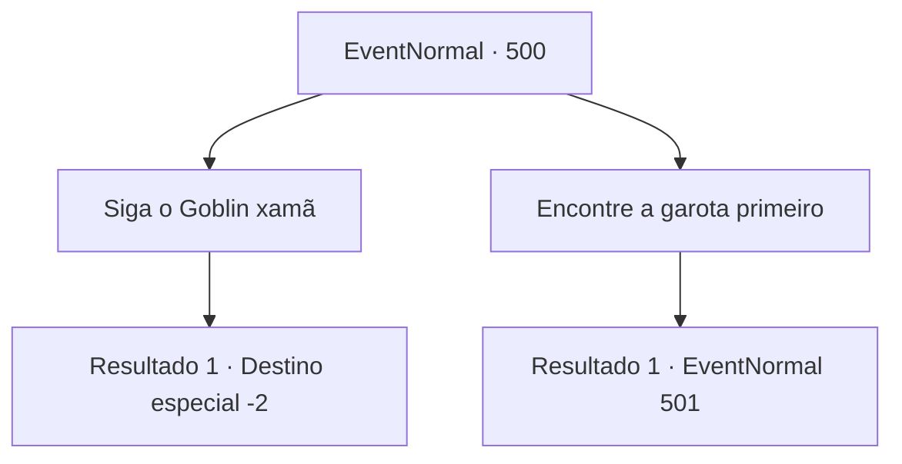

# Eventos normais · 500

[Índice da tabela](index.md) · [Índice geral](../index.md)

ID: `pt:EventNormal:500` · Fonte: `EventNormal4` · Versão: 1.2.47.

Mapeamento estático dos arquivos; a disponibilidade e a execução dependem do estado da run.

## Texto do evento

*Sem texto no arquivo.*

## Dados de entrada

```json
{
  "id": 500,
  "grade": 1,
  "place": "",
  "required": ""
}
```

## Mapa das escolhas



## Escolhas e resultados

### Escolha 1

Siga o Goblin xamã

Requisitos e outros campos da escolha:

```json
{
  "required": ""
}
```

#### Resultado 1.1

Você ignorou a voz e continuou perseguindo o xamã dos goblins. Após uma longa perseguição, você conseguiu capturar o xamã no final da caverna. 

 "Por favor, me poupe...!"

 Você silenciou o xamã dos goblins enquanto ele implorava por sua vida e seguiu em direção ao local de onde a voz vinha. Pouco depois, você chegou ao local onde a voz foi ouvida. Era uma cela improvisada em um canto da caverna. Embora tenha sido construída pelos goblins, era suficiente para manter uma única garota presa. Você arrombou a porta e resgatou a garota que estava lá dentro. No entanto, a garota estava gravemente ferida e à beira da morte. Você voltou para a vila e entregou o corpo da garota ao idoso que pediu sua ajuda. Ele a recebeu tremendo, abraçando-a firmemente e derramando lágrimas. 

 "Minha criança... minha pobre Laila...!"

 Enquanto o idoso chorava amargamente, os moradores da vila o consolaram. Você olhou para o idoso que continuava chorando e silenciosamente partiu da vila.

Continuação registrada: [Destino especial `-2`](../destinos-especiais.md).

```json
{
  "required": "",
  "chance": "1",
  "nextEvent": -2,
  "type": 2,
  "reward": "5_474_10"
}
```

### Escolha 2

Encontre a garota primeiro

Requisitos e outros campos da escolha:

```json
{
  "required": ""
}
```

#### Resultado 2.1

Você decidiu desistir de perseguir o xamã dos goblins e se concentrar em encontrar a garota sequestrada. Seguindo a direção em que a voz da garota foi ouvida, você logo encontrou o local onde ela estava. Era uma cela improvisada em um canto da caverna. Embora tenha sido construída pelos goblins, era suficiente para manter uma única garota presa. Você arrombou a porta e resgatou a garota que estava lá dentro. Ela estava coberta de ferimentos e respirava fracamente.

Continuação registrada: [Evento 501](0501.md) na mesma tabela.

```json
{
  "required": "",
  "chance": "1",
  "nextEvent": 501,
  "type": 2,
  "reward": ""
}
```

## Referências que chegam a este evento

- [Evento 499 · escolha 1 · resultado 1](0499.md#escolha-1)
