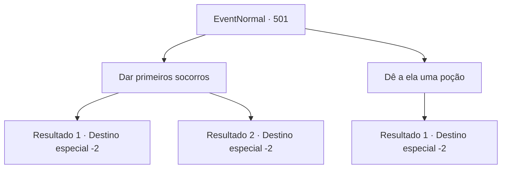

# Eventos normais · 501

[Índice da tabela](index.md) · [Índice geral](../index.md)

ID: `pt:EventNormal:501` · Fonte: `EventNormal4` · Versão: 1.2.47.

Mapeamento estático dos arquivos; a disponibilidade e a execução dependem do estado da run.

## Texto do evento

*Sem texto no arquivo.*

## Dados de entrada

```json
{
  "id": 501,
  "grade": 1,
  "place": "",
  "required": ""
}
```

## Mapa das escolhas



## Escolhas e resultados

### Escolha 1

Dar primeiros socorros

Requisitos e outros campos da escolha:

```json
{
  "required": ""
}
```

#### Resultado 1.1

Após administrar os primeiros socorros, você carregou a garota nos braços e retornou à vila. Felizmente, ela conseguiu se manter viva até chegarem à vila. Assim que vocês chegaram, você imediatamente a entregou aos cuidados de um curandeiro. O curandeiro tratou a garota com urgência, enquanto o ancião que pediu sua ajuda se aproximou e expressou sua gratidão. 

 "Agradeço imensamente, aventureiro. Nunca esquecerei dessa bondade."

 O ancião lhe entregou uma recompensa e imediatamente se aproximou da garota. Você aceitou a recompensa e partiu da vila.

Continuação registrada: [Destino especial `-2`](../destinos-especiais.md).

```json
{
  "required": "",
  "chance": "1|0_7_1",
  "nextEvent": -2,
  "type": 0,
  "reward": "0_2_1|0_4_50|5_474_10"
}
```

#### Resultado 1.2

Você tentou os primeiros socorros, mas a garota morreu. No final, tudo o que você pôde fazer foi carregar o cadáver da garota e seguir para a aldeia.

 Ao chegar na aldeia, você entrega o cadáver da menina ao velho que pediu ajuda. Ele pegou a menina com as mãos trêmulas, abraçou-a com força e chorou. 

 "Minha querida... Rhaela! Meu pobre filhote..."

 Os moradores da vila ofereceram palavras de consolo ao idoso em prantos. Você observou o idoso que não conseguia conter sua tristeza, e então partiu silenciosamente do local.

Continuação registrada: [Destino especial `-2`](../destinos-especiais.md).

```json
{
  "required": "",
  "chance": "8",
  "nextEvent": -2,
  "type": 1,
  "reward": "5_474_10"
}
```

### Escolha 2

Dê a ela uma poção

Requisitos e outros campos da escolha:

```json
{
  "required": "23_6_1"
}
```

#### Resultado 2.1

Você colocou uma poção nos lábios da menina e viu uma melhora em sua cor facial. Felizmente, a poção pareceu ter efeito, pois o rosto da menina ficou mais rosado. Você a pegou nos braços e partiu apressadamente em direção à vila.

 Ao chegar na vila, você entregou a menina adormecida ao idoso. Ele abaixou a cabeça em agradecimento repetidamente. 

 "Obrigado... Muito obrigado, aventureiro. Como posso retribuir essa gentileza...!"

 O idoso lhe entregou uma recompensa e imediatamente se aproximou da menina. Você pegou a recompensa e deixou a vila. Lembre-se de que você deve ser cauteloso ao administrar qualquer substância a alguém e buscar ajuda médica adequada em situações de emergência.

Continuação registrada: [Destino especial `-2`](../destinos-especiais.md).

```json
{
  "required": "",
  "chance": "1",
  "nextEvent": -2,
  "type": 2,
  "reward": "25_6_1|0_2_1|0_4_50|5_474_10"
}
```

## Referências que chegam a este evento

- [Evento 500 · escolha 2 · resultado 1](0500.md#escolha-2)
