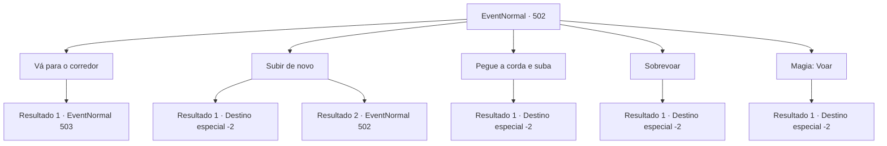

# Eventos normais · 502

[Índice da tabela](index.md) · [Índice geral](../index.md)

ID: `pt:EventNormal:502` · Fonte: `EventNormal4` · Versão: 1.2.47.

Mapeamento estático dos arquivos; a disponibilidade e a execução dependem do estado da run.

## Texto do evento

Você estava atravessando um caminho de montanha quando encontrou um grande buraco, fazendo você parar seus passos. O buraco parecia ter sido criado artificialmente, como se levasse a algum lugar subterrâneo. Cautelosamente, você desceu abaixo do buraco e examinou seus arredores. Logo à sua frente, havia um túnel escavado na terra.

## Dados de entrada

```json
{
  "id": 502,
  "grade": 1,
  "place": "",
  "required": "5_476_0|1_2_20"
}
```

## Mapa das escolhas



## Escolhas e resultados

### Escolha 1

Vá para o corredor

Requisitos e outros campos da escolha:

```json
{
  "required": ""
}
```

#### Resultado 1.1

Você caminhou cautelosamente por um corredor cheio de terra. Embora estivesse bastante escuro lá, o chão era macio e fácil de andar. Após cerca de dez minutos de caminhada, você parou ao chegar a uma encruzilhada à sua frente. As quatro direções da encruzilhada pareciam muito semelhantes, sem características distintas.

Continuação registrada: [Evento 503](0503.md) na mesma tabela.

```json
{
  "required": "",
  "chance": "1",
  "nextEvent": 503,
  "type": 2,
  "reward": "5_476_1"
}
```

### Escolha 2

Subir de novo

Requisitos e outros campos da escolha:

```json
{
  "required": "5_477_0"
}
```

#### Resultado 2.1

Você escalou a parede de terra com as mãos nuas e saiu pelo buraco. Em seguida, limpou as mãos sujas de terra e continuou pelo caminho que estava seguindo.

Continuação registrada: [Destino especial `-2`](../destinos-especiais.md).

```json
{
  "required": "",
  "chance": "1|0_5_1",
  "nextEvent": -2,
  "type": 0,
  "reward": "5_476_10"
}
```

#### Resultado 2.2

Você tentou escalar a parede de terra com as mãos nuas, mas a parede não era sólida o suficiente e desmoronou rapidamente. Você acabou voltando para o seu ponto de partida.

Continuação registrada: [Evento 502](0502.md) na mesma tabela.

```json
{
  "required": "",
  "chance": "11",
  "nextEvent": 502,
  "type": 1,
  "reward": "5_477_1"
}
```

### Escolha 3

Pegue a corda e suba

Requisitos e outros campos da escolha:

```json
{
  "required": "8_39_1"
}
```

#### Resultado 3.1

Você jogou uma corda em uma árvore próxima e a prendeu firmemente. Após verificar se estava bem seguro, você segurou a corda e saiu do buraco.

Continuação registrada: [Destino especial `-2`](../destinos-especiais.md).

```json
{
  "required": "",
  "chance": "1",
  "nextEvent": -2,
  "type": 2,
  "reward": "4_39_1|5_476_10"
}
```

### Escolha 4

Sobrevoar

Requisitos e outros campos da escolha:

```json
{
  "required": "20_10_1"
}
```

#### Resultado 4.1

Você voou para cima e saiu do buraco, superando a gravidade. Depois de se livrar da poeira que cobria seu corpo, você continuou pelo caminho que estava seguindo.

Continuação registrada: [Destino especial `-2`](../destinos-especiais.md).

```json
{
  "required": "",
  "chance": "1",
  "nextEvent": -2,
  "type": 2,
  "reward": "5_476_10"
}
```

### Escolha 5

Magia: Voar

Requisitos e outros campos da escolha:

```json
{
  "required": "20_0_2|1_1_2"
}
```

#### Resultado 5.1

Você voou para cima e saiu do buraco, superando a gravidade. Depois de se livrar da poeira que cobria seu corpo, você continuou pelo caminho que estava seguindo.

Continuação registrada: [Destino especial `-2`](../destinos-especiais.md).

```json
{
  "required": "",
  "chance": "1",
  "nextEvent": -2,
  "type": 2,
  "reward": "0_1_-1|5_476_10"
}
```

## Referências que chegam a este evento

- [Evento 502 · escolha 2 · resultado 2](0502.md#escolha-2)
