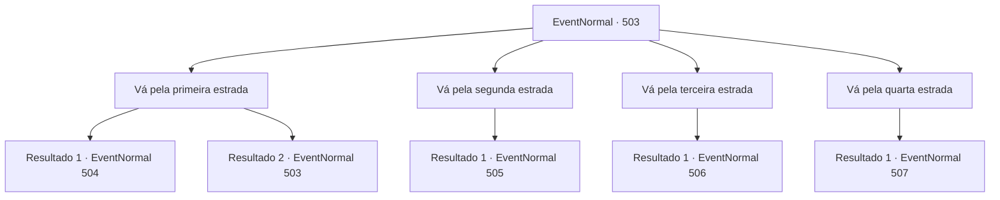

# Eventos normais · 503

[Índice da tabela](index.md) · [Índice geral](../index.md)

ID: `pt:EventNormal:503` · Fonte: `EventNormal4` · Versão: 1.2.47.

Mapeamento estático dos arquivos; a disponibilidade e a execução dependem do estado da run.

## Texto do evento

*Sem texto no arquivo.*

## Dados de entrada

```json
{
  "id": 503,
  "grade": 1,
  "place": "",
  "required": ""
}
```

## Mapa das escolhas



## Escolhas e resultados

### Escolha 1

Vá pela primeira estrada

Requisitos e outros campos da escolha:

```json
{
  "required": "5_478_0"
}
```

#### Resultado 1.1

Você escolheu o primeiro caminho à esquerda no cruzamento. O caminho não era muito diferente dos que você já havia percorrido, exceto por ser um pouco mais amplo e ter pegadas estranhas marcadas nele. Após cerca de cinco minutos de caminhada, você chegou a uma sala espaçosa. Na sala, havia formigas gigantes do tamanho de uma pessoa reunidas. As formigas gigantes olharam para você e imediatamente avançaram em sua direção.

Continuação registrada: [Evento 504](0504.md) na mesma tabela.

```json
{
  "required": "18_479_9",
  "chance": "1",
  "nextEvent": 504,
  "type": 2,
  "reward": "5_478_1|6_3_4",
  "place": 6
}
```

#### Resultado 1.2

Você segue em direção ao primeiro caminho à esquerda na bifurcação.  Mas, ao contrário de antes, o caminho agora está bloqueado por um monte de terra.  O monte está misturado com rochas, mostrando sinais de um deslizamento de terra vindo de cima.  Você terá que escolher outro caminho novamente.

Continuação registrada: [Evento 503](0503.md) na mesma tabela.

```json
{
  "required": "5_479_9",
  "chance": "1",
  "nextEvent": 503,
  "type": 2,
  "reward": "5_478_1"
}
```

### Escolha 2

Vá pela segunda estrada

Requisitos e outros campos da escolha:

```json
{
  "required": "5_479_0"
}
```

#### Resultado 2.1

Você escolheu o segundo caminho à esquerda no cruzamento. Enquanto caminhava, você sentia uma sensação pegajosa no chão e um odor desconhecido enchia o ar. 

 "Uh... Uh..."

 Você acelerou o passo ao ouvir um gemido repentino. Ao chegar ao final do caminho, deparou-se com uma sala repleta de carcaças de animais, frutas e cultivos. Parecia um depósito de alimentos. Dentro dele, havia um homem caído, emitindo gemidos de dor. Você examinou o estado do homem. Ele estava ferido em vários lugares, sangrando profusamente.

Continuação registrada: [Evento 505](0505.md) na mesma tabela.

```json
{
  "required": "",
  "chance": "1",
  "nextEvent": 505,
  "type": 2,
  "reward": "5_479_1"
}
```

### Escolha 3

Vá pela terceira estrada

Requisitos e outros campos da escolha:

```json
{
  "required": "5_480_0"
}
```

#### Resultado 3.1

Você escolheu o terceiro caminho à esquerda no cruzamento. O caminho começou a ficar mais estreito e íngreme,tornando a caminhada um pouco desconfortável. Você se esforçou para fortalecer o tornozelo e avançou com cuidado.

 Após um tempo, você chegou a uma sala cheia de cheiro podre e repleta de montes de terra. O local estava cheio de entulhos. Parecia um lixão.

Continuação registrada: [Evento 506](0506.md) na mesma tabela.

```json
{
  "required": "",
  "chance": "1",
  "nextEvent": 506,
  "type": 2,
  "reward": "5_480_1"
}
```

### Escolha 4

Vá pela quarta estrada

Requisitos e outros campos da escolha:

```json
{
  "required": "5_481_0"
}
```

#### Resultado 4.1

Você entrou na quarta estrada da esquerda em uma bifurcação na estrada. A estrada parecia levar ao centro de uma caverna complexa. A estrada vira à esquerda, vira à direita, desce, sobe.

 'Sons de Pisadas!'

 Enquanto descia a rua, você escuta passos continuos. Quando você finalmente chegou ao fim, percebeu a identidade do som. O lugar em que você está é um formigueiro, e o final da estrada a que você chegou é o quarto da formiga rainha. A formiga rainha gigante e as formigas gigantes próximas moveram suas mandíbulas ameaçadoramente. Logo depois, a rainha e seus cavaleiros atacam você.

Continuação registrada: [Evento 507](0507.md) na mesma tabela.

```json
{
  "required": "",
  "chance": "1",
  "nextEvent": 507,
  "type": 2,
  "reward": "6_3_28|5_481_1",
  "place": 6
}
```

## Referências que chegam a este evento

- [Evento 502 · escolha 1 · resultado 1](0502.md#escolha-1)
- [Evento 503 · escolha 1 · resultado 2](0503.md#escolha-1)
- [Evento 504 · escolha 1 · resultado 1](0504.md#escolha-1)
- [Evento 504 · escolha 2 · resultado 2](0504.md#escolha-2)
- [Evento 505 · escolha 2 · resultado 2](0505.md#escolha-2)
- [Evento 505 · escolha 3 · resultado 1](0505.md#escolha-3)
- [Evento 506 · escolha 1 · resultado 1](0506.md#escolha-1)
- [Evento 506 · escolha 2 · resultado 1](0506.md#escolha-2)
