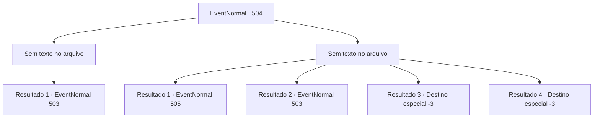

# Eventos normais · 504

[Índice da tabela](index.md) · [Índice geral](../index.md)

ID: `pt:EventNormal:504` · Fonte: `EventNormal4` · Versão: 1.2.47.

Mapeamento estático dos arquivos; a disponibilidade e a execução dependem do estado da run.

## Texto do evento

*Sem texto no arquivo.*

## Dados de entrada

```json
{
  "id": 504,
  "grade": 1,
  "place": "",
  "required": ""
}
```

## Mapa das escolhas



## Escolhas e resultados

### Escolha 1

*Sem texto no arquivo; o papel dessa opção depende da interface do jogo.*

Requisitos e outros campos da escolha:

```json
{
  "required": ""
}
```

#### Resultado 1.1

Você derrotou a colônia de formigas gigantes e seus corpos agora estão espalhados pelo chão, exsudando fluidos pegajosos. Deixando os cadáveres para trás, você retorna ao cruzamento no interior da caverna.

Continuação registrada: [Evento 503](0503.md) na mesma tabela.

```json
{
  "required": "",
  "chance": "1",
  "nextEvent": 503,
  "type": 2,
  "reward": ""
}
```

### Escolha 2

*Sem texto no arquivo; o papel dessa opção depende da interface do jogo.*

Requisitos e outros campos da escolha:

```json
{
  "required": ""
}
```

#### Resultado 2.1

Você foi atacado pelas picadas venenosas das formigas gigantes, o que paralisou seu corpo e mente com intensa dor. As formigas gigantes o arrastaram para algum lugar desconhecido. 

 "Uh... Ugh..."

 Você de repente acorda com gemidos. O local em que você acorda é uma sala cheia de carcaças de animais, frutas, cultivos e outros alimentos. Um homem próximo a você está sofrendo e gemendo. Você avalia o estado do homem, que está ferido e sangrando por vários lugares.

Continuação registrada: [Evento 505](0505.md) na mesma tabela.

```json
{
  "required": "1_0_2|1_1_2|18_479_9",
  "chance": "1",
  "nextEvent": 505,
  "type": 2,
  "reward": "0_0_-1|0_1_-1"
}
```

#### Resultado 2.2

Envenenado pelas formigas gigantes, você já não consegue permanecer consciente. A dor intensa paralisa seu corpo e sua mente. As formigas gigantes arrastam você para algum lugar. 

 De repente, você abre os olhos. Você se encontra na mesma sala que havia visto antes. Carcaças de animais, frutas e colheitas continuam empilhadas, e o cadáver do homem permanece onde estava. Parece que as formigas simplesmente o jogaram em seu depósito de alimentos. Reunindo forças apesar dos ferimentos, você deixa a sala. Pouco depois, a encruzilhada de quatro caminhos que encontrou pela primeira vez surge novamente diante de você.

Continuação registrada: [Evento 503](0503.md) na mesma tabela.

```json
{
  "required": "1_0_2|1_1_2|5_479_9",
  "chance": "1",
  "nextEvent": 503,
  "type": 2,
  "reward": "0_0_-1|0_1_-1"
}
```

#### Resultado 2.3

Você foi picado por uma grande colônia de formigas e não conseguiu recuperar a consciência. A dor intensa paralisou seu corpo e mente. E as formigas gigantes o mataram e o colocaram em um depósito de alimentos.

Continuação registrada: [Destino especial `-3`](../destinos-especiais.md).

```json
{
  "required": "2_0_2",
  "chance": "1",
  "nextEvent": -3,
  "type": 2,
  "reward": "0_0_-1|0_1_-1"
}
```

#### Resultado 2.4

Você foi picado por uma grande colônia de formigas e não conseguiu recuperar a consciência. A dor intensa paralisou seu corpo e mente. E as formigas gigantes o mataram e o colocaram em um depósito de alimentos.

Continuação registrada: [Destino especial `-3`](../destinos-especiais.md).

```json
{
  "required": "2_1_2",
  "chance": "1",
  "nextEvent": -3,
  "type": 2,
  "reward": "0_0_-1|0_1_-1"
}
```

## Referências que chegam a este evento

- [Evento 503 · escolha 1 · resultado 1](0503.md#escolha-1)
