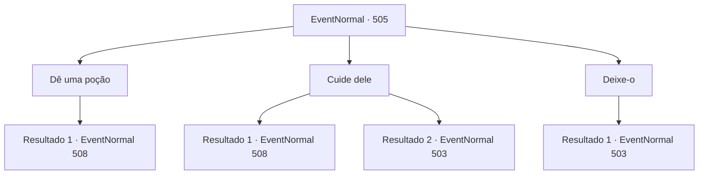

# Eventos normais · 505

[Índice da tabela](index.md) · [Índice geral](../index.md)

ID: `pt:EventNormal:505` · Fonte: `EventNormal4` · Versão: 1.2.47.

Mapeamento estático dos arquivos; a disponibilidade e a execução dependem do estado da run.

## Texto do evento

*Sem texto no arquivo.*

## Dados de entrada

```json
{
  "id": 505,
  "grade": 1,
  "place": "",
  "required": ""
}
```

## Mapa das escolhas



## Escolhas e resultados

### Escolha 1

Dê uma poção

Requisitos e outros campos da escolha:

```json
{
  "required": "23_6_1"
}
```

#### Resultado 1.1

Você cuidadosamente derrama uma poção na boca do homem, e depois de um tempo, ele recupera a consciência. O homem, agora acordado, olha ao redor em pânico e expressa sua gratidão a você. 

 "Ugh... ugh... Obrigado por me salvar. Eu quase fui levado e morto pelas formigas gigantes... Graças a você, estou vivo."

 Ele explica que este lugar é o formigueiro das formigas gigantes, mas felizmente ele se lembra da saída. Ele sugere que vocês partam rapidamente antes que as formigas voltem.

Continuação registrada: [Evento 508](0508.md) na mesma tabela.

```json
{
  "required": "",
  "chance": "1",
  "nextEvent": 508,
  "type": 2,
  "reward": "25_6_1|0_3_1"
}
```

### Escolha 2

Cuide dele

Requisitos e outros campos da escolha:

```json
{
  "required": ""
}
```

#### Resultado 2.1

Você curou o homem. O homem, olhando rapidamente ao redor, expressa gratidão a você. 

 "Ugh... ugh... Obrigado por me salvar. Quase fui levado pelas formigas gigantes e morri... Graças a você estou vivo."

 Ele explica que este lugar é o formigueiro das formigas gigantes e, felizmente, ele se lembra da saída. Ele insiste que vocês devem sair rapidamente antes que as formigas voltem.

Continuação registrada: [Evento 508](0508.md) na mesma tabela.

```json
{
  "required": "",
  "chance": "1|0_7_1",
  "nextEvent": 508,
  "type": 0,
  "reward": "0_3_1"
}
```

#### Resultado 2.2

Você cuidou do homem, envolvendo suas feridas com bandagens, dando-lhe água para beber e limpando o suor de seu corpo. No entanto, apesar de seus esforços, o homem acabou morrendo. Você olhou para o corpo por um momento, refletiu brevemente e então partiu dali. Você viu novamente os quatro caminhos que havia encontrado no início.

Continuação registrada: [Evento 503](0503.md) na mesma tabela.

```json
{
  "required": "",
  "chance": "11",
  "nextEvent": 503,
  "type": 1,
  "reward": "5_479_9"
}
```

### Escolha 3

Deixe-o

Requisitos e outros campos da escolha:

```json
{
  "required": ""
}
```

#### Resultado 3.1

Você saiu de lá ignorando seus colegas de trabalho. Você viu novamente a encruzilhada que encontrou no início.

Continuação registrada: [Evento 503](0503.md) na mesma tabela.

```json
{
  "required": "",
  "chance": "1",
  "nextEvent": 503,
  "type": 2,
  "reward": "5_479_9"
}
```

## Referências que chegam a este evento

- [Evento 503 · escolha 2 · resultado 1](0503.md#escolha-2)
- [Evento 504 · escolha 2 · resultado 1](0504.md#escolha-2)
