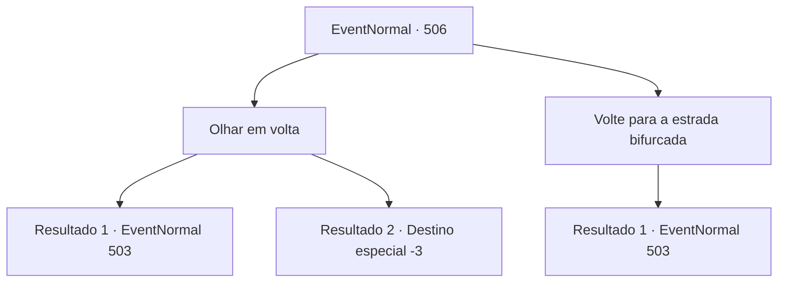

# Eventos normais · 506

[Índice da tabela](index.md) · [Índice geral](../index.md)

ID: `pt:EventNormal:506` · Fonte: `EventNormal4` · Versão: 1.2.47.

Mapeamento estático dos arquivos; a disponibilidade e a execução dependem do estado da run.

## Texto do evento

*Sem texto no arquivo.*

## Dados de entrada

```json
{
  "id": 506,
  "grade": 1,
  "place": "",
  "required": ""
}
```

## Mapa das escolhas



## Escolhas e resultados

### Escolha 1

Olhar em volta

Requisitos e outros campos da escolha:

```json
{
  "required": ""
}
```

#### Resultado 1.1

Você examinou cuidadosamente o local. Enquanto fazia isso, você foi cortado por algo afiado e o sangue jorrou profundamente. Você rapidamente aplicou pressão no ferimento para estancar o sangue. Em seguida, você pegou alguns itens úteis e partiu dali. Não demorou muito para você ver novamente a encruzilhada que encontrou no início.

Continuação registrada: [Evento 503](0503.md) na mesma tabela.

```json
{
  "required": "1_0_2",
  "chance": "1",
  "nextEvent": 503,
  "type": 2,
  "reward": "0_0_-1|0_4_20|3_44_1|3_190_1"
}
```

#### Resultado 1.2

Você examinou minuciosamente o local. Enquanto o fazia, foi acidentalmente cortado por algo afiado, e o sangue jorrou abundantemente. Será que foi por causa do sangue derramado? Ou talvez devido ao fedor nauseante que impregnava o lugar? Você caiu repentinamente tonto e não conseguiu mais se levantar.

Continuação registrada: [Destino especial `-3`](../destinos-especiais.md).

```json
{
  "required": "2_0_2",
  "chance": "1",
  "nextEvent": -3,
  "type": 2,
  "reward": "0_0_-1"
}
```

### Escolha 2

Volte para a estrada bifurcada

Requisitos e outros campos da escolha:

```json
{
  "required": ""
}
```

#### Resultado 2.1

Você deixou aquele lugar e voltou para o local onde havia a encruzilhada.

Continuação registrada: [Evento 503](0503.md) na mesma tabela.

```json
{
  "required": "",
  "chance": "1",
  "nextEvent": 503,
  "type": 2,
  "reward": ""
}
```

## Referências que chegam a este evento

- [Evento 503 · escolha 3 · resultado 1](0503.md#escolha-3)
