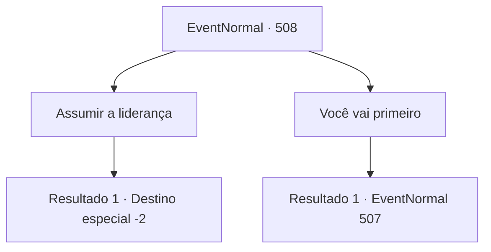

# Eventos normais · 508

[Índice da tabela](index.md) · [Índice geral](../index.md)

ID: `pt:EventNormal:508` · Fonte: `EventNormal4` · Versão: 1.2.47.

Mapeamento estático dos arquivos; a disponibilidade e a execução dependem do estado da run.

## Texto do evento

*Sem texto no arquivo.*

## Dados de entrada

```json
{
  "id": 508,
  "grade": 1,
  "place": "",
  "required": ""
}
```

## Mapa das escolhas



## Escolhas e resultados

### Escolha 1

Assumir a liderança

Requisitos e outros campos da escolha:

```json
{
  "required": ""
}
```

#### Resultado 1.1

Você se adiantou com o colega de trabalho e partiu daquele lugar.

 Felizmente, a afirmação dele de conhecer a saída era verdadeira. Não demorou muito para você chegar à saída e escapar do formigueiro junto com o colega. Aliviado, o colega suspirou e presenteou você com um livro. 

 "Você conseguiu sair vivo graças a você. Isso é um gesto de gratidão, por favor, aceite."

 Ao receber o livro, você trocou cumprimentos com o colega e seguiram caminhos separados.

Continuação registrada: [Destino especial `-2`](../destinos-especiais.md).

```json
{
  "required": "",
  "chance": "1",
  "nextEvent": -2,
  "type": 2,
  "reward": "3_221_1|5_476_10"
}
```

### Escolha 2

Você vai primeiro

Requisitos e outros campos da escolha:

```json
{
  "required": ""
}
```

#### Resultado 2.1

Para garantir que as formigas gigantes não o alcançassem, você decidiu ficar de guarda nas costas do colega de trabalho. Ele agradeceu e entregou o livro. 

 "Obrigado por me salvar. Espero que você consiga sair ileso. Esta é minha pequena retribuição."

 Em seguida, vocês escaparam do formigueiro. No entanto, não demorou muito para que você começasse a ouvir o som das formigas. 'Som dos passos!'

 E então, você se deparou com a gigantesca rainha formiga e as outras formigas gigantes. Elas se moviam ameaçadoramente, com as mandíbulas se movendo, e corriam em sua direção.

Continuação registrada: [Evento 507](0507.md) na mesma tabela.

```json
{
  "required": "",
  "chance": "1",
  "nextEvent": 507,
  "type": 2,
  "reward": "3_221_1|6_3_28",
  "place": 6
}
```

## Referências que chegam a este evento

- [Evento 505 · escolha 1 · resultado 1](0505.md#escolha-1)
- [Evento 505 · escolha 2 · resultado 1](0505.md#escolha-2)
