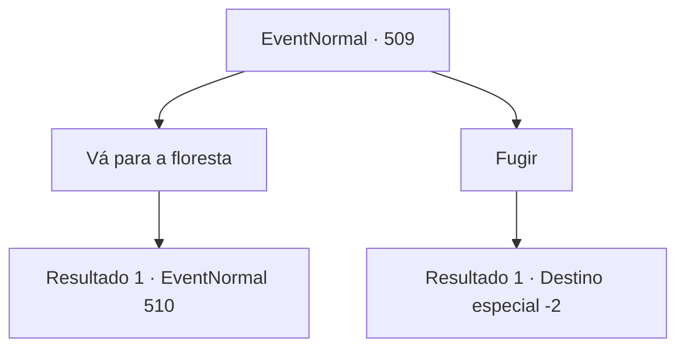

# Eventos normais · 509

[Índice da tabela](index.md) · [Índice geral](../index.md)

ID: `pt:EventNormal:509` · Fonte: `EventNormal4` · Versão: 1.2.47.

Mapeamento estático dos arquivos; a disponibilidade e a execução dependem do estado da run.

## Texto do evento

Você estava indo em direção a algum lugar em um sonho. Era uma floresta profunda, escura e sinistra. Você não sabia por que estava indo para lá, mas não parou de caminhar.

 "Whoooosh."

 De repente, o vento soprou e você abriu os olhos. Você estava parado na entrada daquela floresta que havia visto em seu sonho.

## Dados de entrada

```json
{
  "id": 509,
  "grade": 1,
  "place": "",
  "required": "5_482_0|2_14_10|2_3_-10"
}
```

## Mapa das escolhas



## Escolhas e resultados

### Escolha 1

Vá para a floresta

Requisitos e outros campos da escolha:

```json
{
  "required": ""
}
```

#### Resultado 1.1

Você entrou cuidadosamente na entrada da floresta. Era um lugar profundo, escuro e sinistro, como você havia visto em um sonho. A cada passo que você dava, espinhos negros de videiras se prendiam aos seus tornozelos, e nem mesmo o som comum dos pássaros podia ser ouvido. Enquanto avançava lentamente, de repente, você sentiu uma estranha sensação de desorientação e parou de andar. Mesmo depois de caminhar por um longo tempo, você continuava no meio da floresta.

Continuação registrada: [Evento 510](0510.md) na mesma tabela.

```json
{
  "required": "",
  "chance": "1",
  "nextEvent": 510,
  "type": 2,
  "reward": ""
}
```

### Escolha 2

Fugir

Requisitos e outros campos da escolha:

```json
{
  "required": ""
}
```

#### Resultado 2.1

Você fugiu apressadamente da entrada da floresta. Depois de correr por um tempo, um modesto vilarejo rural apareceu, completamente diferente da escuridão da floresta. Parecia que você havia caído em outro mundo e voltado ao seu mundo original. No entanto, um pressentimento sombrio surgiu, como se você tivesse que retornar àquela floresta mais uma vez.

Continuação registrada: [Destino especial `-2`](../destinos-especiais.md).

```json
{
  "required": "",
  "chance": "1",
  "nextEvent": -2,
  "type": 2,
  "reward": ""
}
```

## Referências que chegam a este evento

Nenhum `nextEvent` positivo da mesma tabela aponta para este nó. Isso não prova que seja inacessível: sorteio e estado de história podem selecioná-lo.

