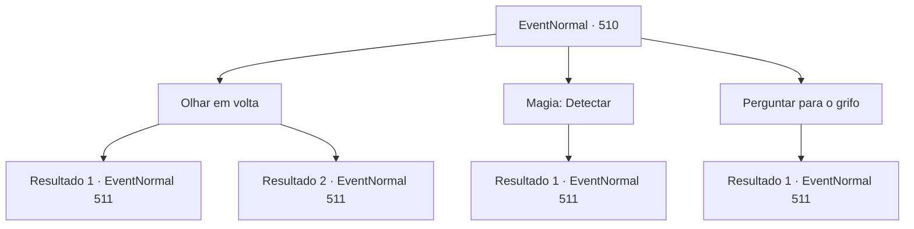

# Eventos normais · 510

[Índice da tabela](index.md) · [Índice geral](../index.md)

ID: `pt:EventNormal:510` · Fonte: `EventNormal4` · Versão: 1.2.47.

Mapeamento estático dos arquivos; a disponibilidade e a execução dependem do estado da run.

## Texto do evento

*Sem texto no arquivo.*

## Dados de entrada

```json
{
  "id": 510,
  "grade": 1,
  "place": "",
  "required": ""
}
```

## Mapa das escolhas



## Escolhas e resultados

### Escolha 1

Olhar em volta

Requisitos e outros campos da escolha:

```json
{
  "required": ""
}
```

#### Resultado 1.1

Você calmamente examinou o ambiente ao seu redor. E, após uma busca, descobriu a razão pela qual estava andando em círculos. A causa eram as videiras negras que estavam espalhadas pela floresta. As videiras escuras, que estavam silenciosamente se movendo, estavam te levando a dar voltas e voltas. Você sacou sua arma e se aproximou do emaranhado de videiras. Então, as videiras negras se lançaram em sua direção, atacando você.

Continuação registrada: [Evento 511](0511.md) na mesma tabela.

```json
{
  "required": "",
  "chance": "1|0_7_1",
  "nextEvent": 511,
  "type": 0,
  "reward": "6_0_64",
  "place": 1
}
```

#### Resultado 1.2

Você examinou calmamente o ambiente ao seu redor. No entanto, mesmo depois de um tempo, não conseguiu descobrir a causa de estar andando em círculos. Sem outra opção, você decidiu pressionar novamente seus passos adiante. Foi nesse momento que o emaranhado de videiras negras, como ondas, surgiu rapidamente atrás de você, atacando.

Continuação registrada: [Evento 511](0511.md) na mesma tabela.

```json
{
  "required": "",
  "chance": "12",
  "nextEvent": 511,
  "type": 1,
  "reward": "6_3_64",
  "place": 1
}
```

### Escolha 2

Magia: Detectar

Requisitos e outros campos da escolha:

```json
{
  "required": "20_0_1"
}
```

#### Resultado 2.1

Você conjurou um feitiço para encontrar o caminho. Foi então que você percebeu que as aparentemente comuns videiras espinhosas estavam se movendo com determinação. Você finalmente percebeu que as videiras espalhadas pelo lugar estavam intencionalmente desorientando você. Você sacou sua arma e se aproximou do emaranhado de videiras. Nesse momento, as videiras negras se lançaram em sua direção, atacando você.

Continuação registrada: [Evento 511](0511.md) na mesma tabela.

```json
{
  "required": "",
  "chance": "1",
  "nextEvent": 511,
  "type": 2,
  "reward": "6_0_64",
  "place": 1
}
```

### Escolha 3

Perguntar para o grifo

Requisitos e outros campos da escolha:

```json
{
  "required": "8_204_1"
}
```

#### Resultado 3.1

Você enviou o grifo para encontrar o caminho. No entanto, em vez de voar para o céu, o grifo atacou as videiras espinhosas próximas. Em resposta ao ataque repentino, as videiras se agitaram e se ergueram, como se estivessem tentando engolir o grifo. Foi só então que você percebeu que as videiras espalhadas pelo lugar não eram simples plantas. Provavelmente, era uma forma desconhecida de videira em movimento, que estava desorientando você. Você rapidamente correu e atacou as videiras espinhosas junto com o grifo.

Continuação registrada: [Evento 511](0511.md) na mesma tabela.

```json
{
  "required": "",
  "chance": "1",
  "nextEvent": 511,
  "type": 2,
  "reward": "6_0_64",
  "place": 1
}
```

## Referências que chegam a este evento

- [Evento 509 · escolha 1 · resultado 1](0509.md#escolha-1)
