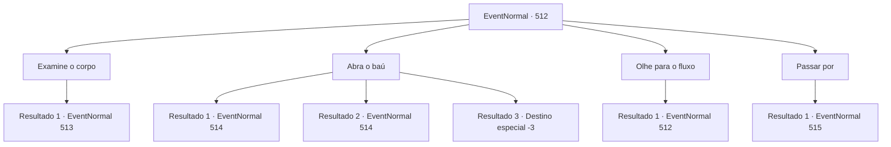

# Eventos normais · 512

[Índice da tabela](index.md) · [Índice geral](../index.md)

ID: `pt:EventNormal:512` · Fonte: `EventNormal4` · Versão: 1.2.47.

Mapeamento estático dos arquivos; a disponibilidade e a execução dependem do estado da run.

## Texto do evento

*Sem texto no arquivo.*

## Dados de entrada

```json
{
  "id": 512,
  "grade": 1,
  "place": "",
  "required": ""
}
```

## Mapa das escolhas



## Escolhas e resultados

### Escolha 1

Examine o corpo

Requisitos e outros campos da escolha:

```json
{
  "required": "5_483_0"
}
```

#### Resultado 1.1

Você examinou os corpos dos aventureiros que pareciam estar mortos. No mesmo instante, os corpos se transformaram em 'alma penada' e se levantaram. Os wights avançaram em sua direção, tentando transformá-lo em um deles, afundando suas presas.

Continuação registrada: [Evento 513](0513.md) na mesma tabela.

```json
{
  "required": "",
  "chance": "1",
  "nextEvent": 513,
  "type": 2,
  "reward": "6_3_89",
  "place": 1
}
```

### Escolha 2

Abra o baú

Requisitos e outros campos da escolha:

```json
{
  "required": "5_484_0"
}
```

#### Resultado 2.1

Enquanto você tentava abrir a caixa, suas afiadas presas foram reveladas. Era um mimico, não apenas uma simples caixa. O mimico abriu sua mandíbula para engoli-lo. Você rapidamente se esquivou do ataque, conseguindo evitar o ataque do mimico. Frustrado por não ter conseguido surpreendê-lo, o mimico atacou você novamente.

Continuação registrada: [Evento 514](0514.md) na mesma tabela.

```json
{
  "required": "",
  "chance": "1|0_6_1",
  "nextEvent": 514,
  "type": 0,
  "reward": "6_0_100",
  "place": 1
}
```

#### Resultado 2.2

Você estava prestes a abrir a caixa quando de repente suas afiadas presas foram reveladas. Era um mimico, não apenas uma simples caixa. O mimico abriu sua mandíbula para engoli-lo. Você rapidamente se esquivou do ataque, conseguindo evitar o ataque do mimico. Seu antebraço foi cortado e sangrava, mas não era um ferimento fatal. Você olhou para a caixa revelada em sua verdadeira forma. O mimico, frustrado por sua tentativa fracassada, se preparou para atacar você novamente.

Continuação registrada: [Evento 514](0514.md) na mesma tabela.

```json
{
  "required": "1_0_2",
  "chance": "13",
  "nextEvent": 514,
  "type": 1,
  "reward": "0_0_-1|6_0_100",
  "place": 1
}
```

#### Resultado 2.3

Quando você estava prestes a abrir o baú, sua boca se abriu de repente. Então ele o engoliu inteiro e o mastigou com seus dentes afiados. Só então você percebeu que a caixa era um Mimic. Mas já era tarde demais.

Continuação registrada: [Destino especial `-3`](../destinos-especiais.md).

```json
{
  "required": "2_0_2",
  "chance": "13",
  "nextEvent": -3,
  "type": 1,
  "reward": "0_0_-1"
}
```

### Escolha 3

Olhe para o fluxo

Requisitos e outros campos da escolha:

```json
{
  "required": "5_485_0"
}
```

#### Resultado 3.1

Você examinou a água negra e enegrecida e percebeu não apenas sua cor escura, mas também o cheiro desagradável que emanava dela. Após um tempo observando a água, você decidiu jogar um pedaço de carne seca nela. Borbulhos começaram a se formar e a carne se dissolveu. Ao testemunhar essa reação, você percebeu que a água negra estava carregada de acidez.

Continuação registrada: [Evento 512](0512.md) na mesma tabela.

```json
{
  "required": "",
  "chance": "1",
  "nextEvent": 512,
  "type": 2,
  "reward": "5_485_1"
}
```

### Escolha 4

Passar por

Requisitos e outros campos da escolha:

```json
{
  "required": "-1|5_483_1|5_484_1|5_485_1"
}
```

#### Resultado 4.1

Você continuou caminhando, passando pelo local e seguindo em direção a um lugar mais profundo.

 Cerca de uma hora depois, uma voz estranha ecoou de algum lugar. A voz veio acompanhada de uma névoa turva e era semelhante à de um velho. 

 "Hehehe. Você veio muito bem. Tolo humano."

 Em seguida, o dono da voz surgiu da névoa. Ao identificar sua identidade, você sentiu um claro sentimento de hostilidade e empunhou sua arma. O dono da voz estranha era a infame bruxa malévola, conhecida como 'Night Hag'. A risada sombria da Night Hag manchou seus ouvidos. 

 "Aqui é minha terra, meu templo e minha casa. Há apenas uma maneira de sair daqui: oferecer-me sua alma ou algo equivalente. Agora, o que você fará?"


Continuação registrada: [Evento 515](0515.md) na mesma tabela.

```json
{
  "required": "",
  "chance": "1",
  "nextEvent": 515,
  "type": 2,
  "reward": ""
}
```

## Referências que chegam a este evento

- [Evento 511 · escolha 1 · resultado 1](0511.md#escolha-1)
- [Evento 512 · escolha 3 · resultado 1](0512.md#escolha-3)
- [Evento 513 · escolha 1 · resultado 1](0513.md#escolha-1)
- [Evento 514 · escolha 1 · resultado 1](0514.md#escolha-1)
