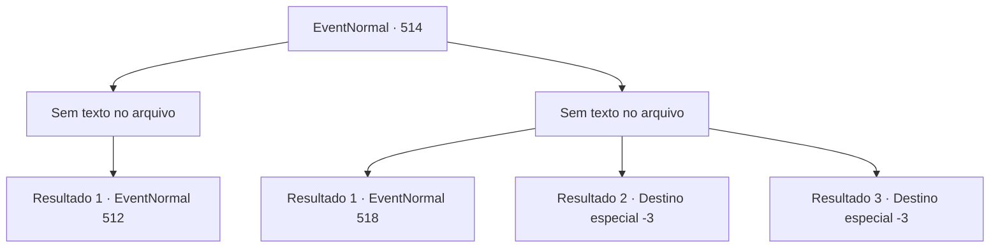

# Eventos normais · 514

[Índice da tabela](index.md) · [Índice geral](../index.md)

ID: `pt:EventNormal:514` · Fonte: `EventNormal4` · Versão: 1.2.47.

Mapeamento estático dos arquivos; a disponibilidade e a execução dependem do estado da run.

## Texto do evento

*Sem texto no arquivo.*

## Dados de entrada

```json
{
  "id": 514,
  "grade": 1,
  "place": "",
  "required": ""
}
```

## Mapa das escolhas



## Escolhas e resultados

### Escolha 1

*Sem texto no arquivo; o papel dessa opção depende da interface do jogo.*

Requisitos e outros campos da escolha:

```json
{
  "required": ""
}
```

#### Resultado 1.1

Você derrotou o mimico e explorou seu interior. Embora tenha encontrado um pouco de ouro, não havia nenhum item especial. Você voltou a olhar para o local onde o riacho negro fluía.

Continuação registrada: [Evento 512](0512.md) na mesma tabela.

```json
{
  "required": "",
  "chance": "1",
  "nextEvent": 512,
  "type": 2,
  "reward": "0_4_20|5_484_1"
}
```

### Escolha 2

*Sem texto no arquivo; o papel dessa opção depende da interface do jogo.*

Requisitos e outros campos da escolha:

```json
{
  "required": ""
}
```

#### Resultado 2.1

Você fugiu desesperadamente daquele lugar após ser derrotado pelo mimico. No entanto, você acabou perdendo o equilíbrio e caindo do penhasco. Logo, a paisagem sombria da floresta deixou de ser visível.

 Quanto tempo você ficou inconsciente desde então? Ao recobrar a consciência, você olhou ao redor. Grossos troncos de árvores estavam te prendendo firmemente. 

 "Hehehe. Você acordou. Que tolo, humano."

 Alguém riu ao ver você nessa situação. Emergindo da névoa, estava a temida 'Bruxa da Noite', uma bruxa malévola famosa. Você lutou para se libertar do aperto. Mas, ao invés de se soltar, você sentiu sua energia diminuindo gradualmente. Era como se sua vida estivesse se esvaindo lentamente.

Continuação registrada: [Evento 518](0518.md) na mesma tabela.

```json
{
  "required": "1_0_2|1_1_2",
  "chance": "1",
  "nextEvent": 518,
  "type": 2,
  "reward": "0_0_-1|0_1_-1"
}
```

#### Resultado 2.2

O Mimic mastigou você eo engoliu em uma mordida. Você encontrou seu fim, sentindo a dor de ter seu corpo dilacerado.

Continuação registrada: [Destino especial `-3`](../destinos-especiais.md).

```json
{
  "required": "2_0_2",
  "chance": "1",
  "nextEvent": -3,
  "type": 2,
  "reward": "0_0_-1|0_1_-1"
}
```

#### Resultado 2.3

O Mimic mastigou você eo engoliu em uma mordida. Você encontrou seu fim, sentindo a dor de ter seu corpo dilacerado.

Continuação registrada: [Destino especial `-3`](../destinos-especiais.md).

```json
{
  "required": "2_1_2",
  "chance": "1",
  "nextEvent": -3,
  "type": 2,
  "reward": "0_0_-1|0_1_-1"
}
```

## Referências que chegam a este evento

- [Evento 512 · escolha 2 · resultado 1](0512.md#escolha-2)
- [Evento 512 · escolha 2 · resultado 2](0512.md#escolha-2)
