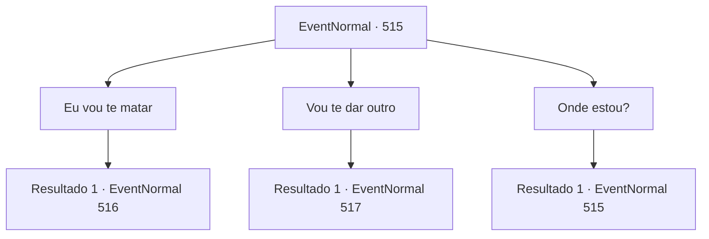

# Eventos normais · 515

[Índice da tabela](index.md) · [Índice geral](../index.md)

ID: `pt:EventNormal:515` · Fonte: `EventNormal4` · Versão: 1.2.47.

Mapeamento estático dos arquivos; a disponibilidade e a execução dependem do estado da run.

## Texto do evento

*Sem texto no arquivo.*

## Dados de entrada

```json
{
  "id": 515,
  "grade": 1,
  "place": "",
  "required": ""
}
```

## Mapa das escolhas



## Escolhas e resultados

### Escolha 1

Eu vou te matar

Requisitos e outros campos da escolha:

```json
{
  "required": ""
}
```

#### Resultado 1.1

A Bruxa da Noite sorriu perversamente com sua resposta. 

 "Hahaha ha! Voce é uma pessoa muito saudável, então vou roubar sua alma à força!"

 Um pedaço de magia negra irradiou da mão da Bruxa e voou em sua direção. Você se esquivou do ataque com uma rajada e avançou na Bruxa da Noite.

Continuação registrada: [Evento 516](0516.md) na mesma tabela.

```json
{
  "required": "",
  "chance": "1",
  "nextEvent": 516,
  "type": 2,
  "reward": "6_3_143",
  "place": 1
}
```

### Escolha 2

Vou te dar outro

Requisitos e outros campos da escolha:

```json
{
  "required": ""
}
```

#### Resultado 2.1

Os olhos de Night Hag se iluminaram com interesse em sua resposta. 

 "Hahahaha. Boa noite. Então o que você vai pagar?"

 A Bruxa da Noite perguntou, mostrando seus dentes podres.

Continuação registrada: [Evento 517](0517.md) na mesma tabela.

```json
{
  "required": "",
  "chance": "1",
  "nextEvent": 517,
  "type": 2,
  "reward": ""
}
```

### Escolha 3

Onde estou?

Requisitos e outros campos da escolha:

```json
{
  "required": "5_486_0"
}
```

#### Resultado 3.1

Com a sua pergunta, a Bruxa da Noite soltou uma risada maliciosa mais uma vez. O olhar dela em você era como o de um predador olhando para uma presa. 

 "Você é mais burro do que parece. Haha. Então vou explicar para você também. Os magos do plano material chamam este lugar assim. 'Dimensão do Mal'."

 Essa afirmação significa que o bosque em que você está agora não faz parte do plano material.

Continuação registrada: [Evento 515](0515.md) na mesma tabela.

```json
{
  "required": "",
  "chance": "1",
  "nextEvent": 515,
  "type": 2,
  "reward": "5_486_10"
}
```

## Referências que chegam a este evento

- [Evento 512 · escolha 4 · resultado 1](0512.md#escolha-4)
- [Evento 515 · escolha 3 · resultado 1](0515.md#escolha-3)
