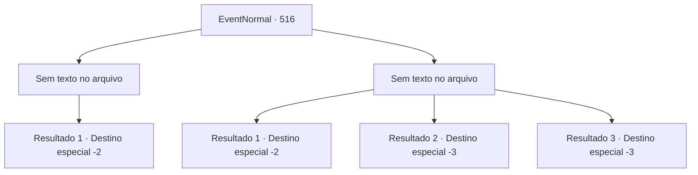

# Eventos normais · 516

[Índice da tabela](index.md) · [Índice geral](../index.md)

ID: `pt:EventNormal:516` · Fonte: `EventNormal4` · Versão: 1.2.47.

Mapeamento estático dos arquivos; a disponibilidade e a execução dependem do estado da run.

## Texto do evento

*Sem texto no arquivo.*

## Dados de entrada

```json
{
  "id": 516,
  "grade": 1,
  "place": "",
  "required": ""
}
```

## Mapa das escolhas



## Escolhas e resultados

### Escolha 1

*Sem texto no arquivo; o papel dessa opção depende da interface do jogo.*

Requisitos e outros campos da escolha:

```json
{
  "required": ""
}
```

#### Resultado 1.1

Depois de uma batalha intensa, você saiu vitorioso. Você se aproximou da Bruxa da Noite que estava no chão e separou seu corpo da cabeça. Nesse momento, o mundo sombrio começou a desaparecer como poeira. 

 "Não é possível..."

 A Bruxa da Noite, que murmurava enquanto só restava a cabeça, também se transformou em cinzas e desapareceu, deixando para trás apenas sua foice encadeada. De repente, o sol da manhã surgiu iluminando o mundo. Você percebeu que estava envolvido pela luz e havia retornado ao seu mundo original.

Continuação registrada: [Destino especial `-2`](../destinos-especiais.md).

```json
{
  "required": "",
  "chance": "1",
  "nextEvent": -2,
  "type": 2,
  "reward": "3_166_1|0_12_1|5_482_10"
}
```

### Escolha 2

*Sem texto no arquivo; o papel dessa opção depende da interface do jogo.*

Requisitos e outros campos da escolha:

```json
{
  "required": ""
}
```

#### Resultado 2.1

À medida que a batalha se prolongava, você sentia que sua expressão facial ficava cada vez mais sombria. Em algum momento, seu corpo estava encharcado de suor e seu braço tremia segurando a arma. 

 "Tsk! É inútil resistir!"

 Bruxa da Noite reuniu uma massa de energia negra enquanto rosnava. Você também se preparou para desferir um golpe contra Bruxa da Noite. No entanto, foi exatamente nesse momento que o mundo sombrio começou a desaparecer como poeira. 

 "Grrr! Parece que o tempo acabou! Considere-se sortudo!"

 A voz furiosa da Bruxa da Noite também gradualmente desapareceu de vista. De repente, o sol da manhã surgiu iluminando o mundo. Enquanto observava aquela luz brilhante, você percebeu que havia retornado ao seu mundo original.

Continuação registrada: [Destino especial `-2`](../destinos-especiais.md).

```json
{
  "required": "1_0_2|1_1_2",
  "chance": "1",
  "nextEvent": -2,
  "type": 2,
  "reward": "0_0_-1|0_1_-1|5_482_10"
}
```

#### Resultado 2.2

Você foi atingido pela maligna magia de Bruxa da Noite. Seus braços e pernas não se moviam, e você não conseguia ver à sua frente. Gradualmente, ficou sem ar e sentiu sua vida se esvaindo. 

 "Hahahaha. Vou aproveitar bem a sua alma."

 Não demorou muito para que, acompanhado pelo riso malicioso da Bruxa da Noite, sua vida se extinguisse completamente.

Continuação registrada: [Destino especial `-3`](../destinos-especiais.md).

```json
{
  "required": "2_0_2",
  "chance": "1",
  "nextEvent": -3,
  "type": 2,
  "reward": "0_0_-1|0_1_-1"
}
```

#### Resultado 2.3

Você foi atingido pela maligna magia de Bruxa da Noite. Seus braços e pernas não se moviam, e você não conseguia ver à sua frente. Gradualmente, ficou sem ar e sentiu sua vida se esvaindo. 

 "Hahahaha. Vou aproveitar bem a sua alma."

 Não demorou muito para que, acompanhado pelo riso malicioso da Bruxa da Noite, sua vida se extinguisse completamente.

Continuação registrada: [Destino especial `-3`](../destinos-especiais.md).

```json
{
  "required": "2_1_2",
  "chance": "1",
  "nextEvent": -3,
  "type": 2,
  "reward": "0_0_-1|0_1_-1"
}
```

## Referências que chegam a este evento

- [Evento 515 · escolha 1 · resultado 1](0515.md#escolha-1)
- [Evento 517 · escolha 1 · resultado 1](0517.md#escolha-1)
- [Evento 517 · escolha 3 · resultado 1](0517.md#escolha-3)
- [Evento 518 · escolha 1 · resultado 1](0518.md#escolha-1)
- [Evento 518 · escolha 1 · resultado 2](0518.md#escolha-1)
