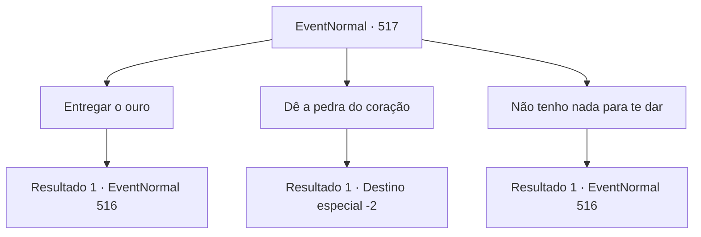

# Eventos normais · 517

[Índice da tabela](index.md) · [Índice geral](../index.md)

ID: `pt:EventNormal:517` · Fonte: `EventNormal4` · Versão: 1.2.47.

Mapeamento estático dos arquivos; a disponibilidade e a execução dependem do estado da run.

## Texto do evento

*Sem texto no arquivo.*

## Dados de entrada

```json
{
  "id": 517,
  "grade": 1,
  "place": "",
  "required": ""
}
```

## Mapa das escolhas



## Escolhas e resultados

### Escolha 1

Entregar o ouro

Requisitos e outros campos da escolha:

```json
{
  "required": "1_4_10"
}
```

#### Resultado 1.1

Você propôs ouro como parte da negociação. A Bruxa da Noite zombou de você e riu com desdém. 

 "Você acha que sua mera pilha de ouro é suficiente para sua alma? Haha! Que tolice!"

 Uma aura de energia negra emanava das mãos da Bruxa. Essas energias negras se uniram rapidamente e voaram em sua direção.

Continuação registrada: [Evento 516](0516.md) na mesma tabela.

```json
{
  "required": "",
  "chance": "1",
  "nextEvent": 516,
  "type": 2,
  "reward": "6_3_143",
  "place": 1
}
```

### Escolha 2

Dê a pedra do coração

Requisitos e outros campos da escolha:

```json
{
  "required": "8_244_1"
}
```

#### Resultado 2.1

Você ofereceu uma pedra de coração como condição para a negociação. A voz da Bruxa da Noite subiu uma oitava, como se estivesse arranhando o ferro ao ouvir isso. 

 "Oh! Então você tinha isso! Não é de se admirar que tenha vindo tão facilmente para a minha área. Muito bem, vou aceitar isso. Agora, me dê!"

 Seus olhos estavam repentinamente cheios de ganância. Você entregou a pedra de coração a Bruxa da Noite e exigiu que ela o devolvesse ao seu mundo original. No entanto, ela te empurrou de forma negligente como se estivesse incomodada. 

 "Ótimo. Agora que consegui algo valioso, mantenha sua promessa e suma daqui."

 Empurrado pela Bruxa da Noite, você caiu em um buraco sem fim. Sua consciência se turvou instantaneamente.

 De repente, você recobrou a consciência e olhou ao redor. O sol da manhã estava brilhando, iluminando o mundo. Ao ver aquela luz radiante, você percebeu que tinha retornado ao seu mundo original.

Continuação registrada: [Destino especial `-2`](../destinos-especiais.md).

```json
{
  "required": "",
  "chance": "1",
  "nextEvent": -2,
  "type": 2,
  "reward": "4_244_1|5_482_10"
}
```

### Escolha 3

Não tenho nada para te dar

Requisitos e outros campos da escolha:

```json
{
  "required": ""
}
```

#### Resultado 3.1

Você percebeu que não tinha nada para oferecer e hesitou. Nesse momento, a Bruxa da Noite pareceu perceber seus pensamentos e zombou de você, contorcendo o rosto. 

 "Propor uma negociação sem ter nada para oferecer?"

 Uma aura de energia negra emanava das mãos de Heg. Essas energias negras se uniram rapidamente e voaram em sua direção.

Continuação registrada: [Evento 516](0516.md) na mesma tabela.

```json
{
  "required": "",
  "chance": "1",
  "nextEvent": 516,
  "type": 2,
  "reward": "6_3_143",
  "place": 1
}
```

## Referências que chegam a este evento

- [Evento 515 · escolha 2 · resultado 1](0515.md#escolha-2)
