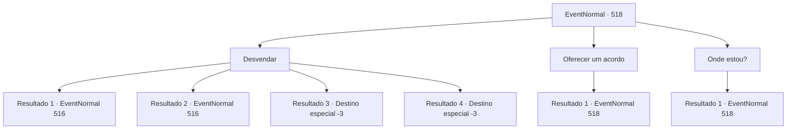

# Eventos normais · 518

[Índice da tabela](index.md) · [Índice geral](../index.md)

ID: `pt:EventNormal:518` · Fonte: `EventNormal4` · Versão: 1.2.47.

Mapeamento estático dos arquivos; a disponibilidade e a execução dependem do estado da run.

## Texto do evento

*Sem texto no arquivo.*

## Dados de entrada

```json
{
  "id": 518,
  "grade": 1,
  "place": "",
  "required": ""
}
```

## Mapa das escolhas



## Escolhas e resultados

### Escolha 1

Desvendar

Requisitos e outros campos da escolha:

```json
{
  "required": ""
}
```

#### Resultado 1.1

Você rapidamente se libertou dos galhos que envolviam seu corpo e sacou sua arma. Ao ver essa cena, a Bruxa da Noite pareceu surpresa, mas logo revelou sua verdadeira natureza e se preparou para lutar. 

 "Hahahaha! Você é bem resistente. Vou matá-lo e roubar sua alma!"

 Uma massa de energia negra se estendeu da mão de Heg e voou em sua direção. Você se esquivou do ataque ao saltar no ar e avançou em direção a Bruxa da Noite.

Continuação registrada: [Evento 516](0516.md) na mesma tabela.

```json
{
  "required": "",
  "chance": "1|0_6_1",
  "nextEvent": 516,
  "type": 0,
  "reward": "6_3_143",
  "place": 1
}
```

#### Resultado 1.2

Você fez um esforço para se libertar do aperto. No entanto, os galhos que te prendiam ficaram ainda mais fortes, apertando ainda mais. Sem outra opção, você teve que arrancar suas articulações e se forçar a se soltar. Uma intensa dor se espalhou pelo ombro e cotovelo. 

 "Hahahaha! Você é bem resistente. Vou ti matar e roubar sua alma!"

 Ao ver essa cena, a Bruxa da Noite revelou sua verdadeira natureza e começou a atacar. Uma massa de energia negra se estendia da mão da Bruxa e voou em sua direção. Você se esquivou do ataque ao se lançar para o ar e avançou em direção a Bruxa da Noite.

Continuação registrada: [Evento 516](0516.md) na mesma tabela.

```json
{
  "required": "1_0_2",
  "chance": "13",
  "nextEvent": 516,
  "type": 1,
  "reward": "0_0_-1|6_3_143",
  "place": 1
}
```

#### Resultado 1.3

Você fez um esforço para se libertar do aperto. No entanto, os galhos que te prendiam ficaram ainda mais fortes, apertando com mais força. Você sentiu sua força se esvaindo gradualmente do corpo. No final, até mesmo sua consciência se apagou como uma vela.

Continuação registrada: [Destino especial `-3`](../destinos-especiais.md).

```json
{
  "required": "2_0_2",
  "chance": "13",
  "nextEvent": -3,
  "type": 1,
  "reward": "0_0_-1|0_1_-1"
}
```

#### Resultado 1.4

Você fez um esforço para se libertar do aperto. No entanto, os galhos que te prendiam ficaram ainda mais fortes, apertando com mais força. Você sentiu sua força se esvaindo gradualmente do corpo. No final, até mesmo sua consciência se apagou como uma vela.

Continuação registrada: [Destino especial `-3`](../destinos-especiais.md).

```json
{
  "required": "2_1_2",
  "chance": "13",
  "nextEvent": -3,
  "type": 1,
  "reward": "0_0_-1|0_1_-1"
}
```

### Escolha 2

Oferecer um acordo

Requisitos e outros campos da escolha:

```json
{
  "required": "5_487_0"
}
```

#### Resultado 2.1

Você propôs uma negociação a Bruxa da Noite. Você ofereceu uma compensação adequada em troca de ser liberado e enviado de volta ao seu lugar de origem. No entanto, a Bruxa da Noite explodiu em risadas. 

 "Hahaha! Que tolo você é. Eu já te capturei, então por que eu deveria considerar qualquer tipo de negociação?"

 Pelos comentários da Bruxa da Noite, ficou claro para você que não havia espaço para negociação ou acordo.

Continuação registrada: [Evento 518](0518.md) na mesma tabela.

```json
{
  "required": "",
  "chance": "1",
  "nextEvent": 518,
  "type": 2,
  "reward": "5_487_1"
}
```

### Escolha 3

Onde estou?

Requisitos e outros campos da escolha:

```json
{
  "required": "5_486_0"
}
```

#### Resultado 3.1

Você perguntou a Bruxa da Noite onde exatamente você estava. Em resposta à sua pergunta, a Bruxa da Noite soltou uma risada maliciosa mais uma vez. O olhar dela em você era como o de um predador olhando para uma presa. 

 "Você é mais burro do que parece. Haha. Então vou explicar para você também. Os magos do plano material chamam este lugar assim. 'Dimensão do Mal'."

 Essa afirmação significa que o bosque em que você está agora não faz parte do plano material.

Continuação registrada: [Evento 518](0518.md) na mesma tabela.

```json
{
  "required": "",
  "chance": "1",
  "nextEvent": 518,
  "type": 2,
  "reward": "5_486_10"
}
```

## Referências que chegam a este evento

- [Evento 511 · escolha 2 · resultado 1](0511.md#escolha-2)
- [Evento 513 · escolha 2 · resultado 1](0513.md#escolha-2)
- [Evento 514 · escolha 2 · resultado 1](0514.md#escolha-2)
- [Evento 518 · escolha 2 · resultado 1](0518.md#escolha-2)
- [Evento 518 · escolha 3 · resultado 1](0518.md#escolha-3)
