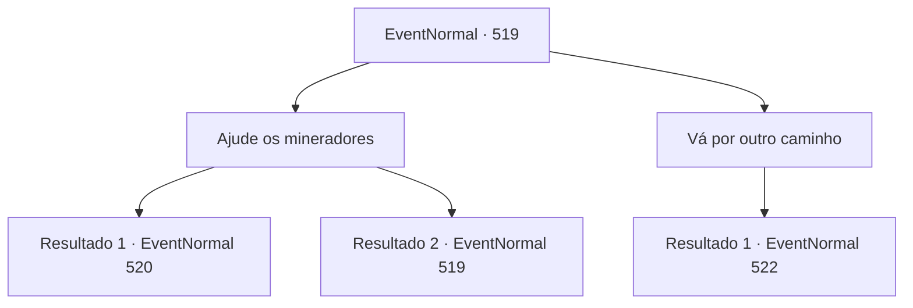

# Eventos normais · 519

[Índice da tabela](index.md) · [Índice geral](../index.md)

ID: `pt:EventNormal:519` · Fonte: `EventNormal4` · Versão: 1.2.47.

Mapeamento estático dos arquivos; a disponibilidade e a execução dependem do estado da run.

## Texto do evento

Você encontrou seu caminho bloqueado por uma pilha de pedras. Você ouviu o mineiro concentrado em trabalhos de recuperação mencionando que houve um deslizamento de terra alguns dias atrás. Sem outra opção, você teve que mudar de direção para encontrar outro caminho. Foi então que o mineiro que havia falado com você sobre a situação segurou seu ombro. 

 "Espere um minuto! Há uma cobra gigante por ali. Dizem que ela devora viajantes"

 disse ele, balançando a cabeça ao mencionar os viajantes que já haviam sido devorados. 

 "Se você quiser passar pelo túnel, é melhor esperar pacientemente. Ou talvez você possa ajudar a abrir o túnel junto com a gente?"


## Dados de entrada

```json
{
  "id": 519,
  "grade": 1,
  "place": "",
  "required": "5_488_0"
}
```

## Mapa das escolhas



## Escolhas e resultados

### Escolha 1

Ajude os mineradores

Requisitos e outros campos da escolha:

```json
{
  "required": "5_489_0"
}
```

#### Resultado 1.1

Você pediu emprestado uma picareta aos mineiros e se juntou aos esforços de recuperação. Quando você usou sua força para quebrar os montes de pedra, um túnel foi revelado em um instante. O interior do túnel estava um pouco escuro, mas não representava problema para você atravessar. Você cumprimentou os mineiros e adentrou o túnel.

 Cerca de trinta minutos se passaram desde que você começou a caminhar pelo túnel. Em um local não muito distante, você avistou algo se movendo. No entanto, devido à escuridão do ambiente, não era possível discernir o que exatamente estava se movendo.

Continuação registrada: [Evento 520](0520.md) na mesma tabela.

```json
{
  "required": "",
  "chance": "1|0_5_1",
  "nextEvent": 520,
  "type": 0,
  "reward": "3_44_1"
}
```

#### Resultado 1.2

Você pediu emprestado uma picareta aos mineiros e se juntou aos esforços de recuperação. No entanto, remover a pilha de pedras era uma tarefa desafiadora. Mesmo depois de trabalhar duro com a picareta, o progresso parecia insignificante, e a sensação de cansaço só aumentava. No final, exausto, você lançou a picareta para longe.

Continuação registrada: [Evento 519](0519.md) na mesma tabela.

```json
{
  "required": "",
  "chance": "13",
  "nextEvent": 519,
  "type": 1,
  "reward": "5_489_1"
}
```

### Escolha 2

Vá por outro caminho

Requisitos e outros campos da escolha:

```json
{
  "required": ""
}
```

#### Resultado 2.1

Após encontrar o caminho bloqueado pela pilha de pedras, você decidiu seguir por uma rota alternativa. A trilha que serpenteava pelas montanhas era um pouco desafiadora, mas não representava um problema para você. 

 "Aaaah!! Alguém me ajude!"

 Enquanto você subia pela encosta da montanha, ouviu um grito de socorro vindo de um matagal próximo. Você correu na direção do som e viu a cena descrita pelos mineiros. Uma serpente gigantesca, com cerca de 40 pés de comprimento, estava segurando um viajante em suas mandíbulas abertas.

Continuação registrada: [Evento 522](0522.md) na mesma tabela.

```json
{
  "required": "",
  "chance": "1",
  "nextEvent": 522,
  "type": 2,
  "reward": ""
}
```

## Referências que chegam a este evento

- [Evento 519 · escolha 1 · resultado 2](0519.md#escolha-1)
