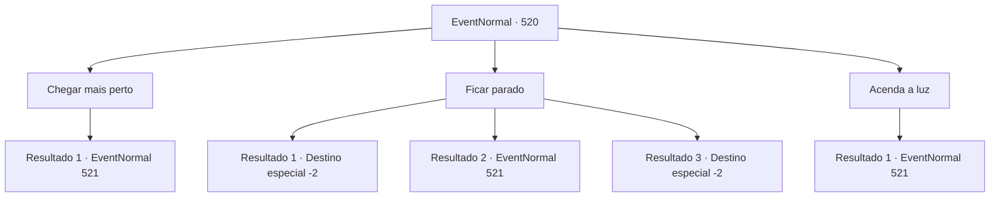

# Eventos normais · 520

[Índice da tabela](index.md) · [Índice geral](../index.md)

ID: `pt:EventNormal:520` · Fonte: `EventNormal4` · Versão: 1.2.47.

Mapeamento estático dos arquivos; a disponibilidade e a execução dependem do estado da run.

## Texto do evento

*Sem texto no arquivo.*

## Dados de entrada

```json
{
  "id": 520,
  "grade": 1,
  "place": "",
  "required": ""
}
```

## Mapa das escolhas



## Escolhas e resultados

### Escolha 1

Chegar mais perto

Requisitos e outros campos da escolha:

```json
{
  "required": ""
}
```

#### Resultado 1.1

Você se aproximou com cautela daquela criatura de identidade desconhecida. No entanto, assim que percebeu sua presença, ela saltou em sua direção. Ao se aproximar, você sentiu um odor desagradável que revelou a verdadeira identidade do ser. Era um 'Pudim Negro'. Você rapidamente sacou sua arma para evitar se tornar a presa do Pudim Negro.

Continuação registrada: [Evento 521](0521.md) na mesma tabela.

```json
{
  "required": "",
  "chance": "1",
  "nextEvent": 521,
  "type": 2,
  "reward": "6_0_142",
  "place": 1
}
```

### Escolha 2

Ficar parado

Requisitos e outros campos da escolha:

```json
{
  "required": ""
}
```

#### Resultado 2.1

Você parou e observou atentamente a criatura. Ela ficou parada por um momento e depois se escondeu lentamente, desaparecendo de vista. Após verificar que a criatura havia desaparecido completamente, você continuou sua jornada. Não demorou muito para que a paisagem fora do túnel começasse a aparecer diante dos seus olhos.

Continuação registrada: [Destino especial `-2`](../destinos-especiais.md).

```json
{
  "required": "21_5_1",
  "chance": "1|0_6_1",
  "nextEvent": -2,
  "type": 0,
  "reward": "0_2_1|5_488_10"
}
```

#### Resultado 2.2

Você parou e observou a criatura com cuidado. No entanto, ela percebeu sua presença e avançou em sua direção. Você reconheceu o cheiro desagradável que vinha dela, percebendo a identidade do seu oponente. Era um 'Pudim Negro'. Para evitar se tornar sua presa, você rapidamente sacou sua arma.

Continuação registrada: [Evento 521](0521.md) na mesma tabela.

```json
{
  "required": "21_5_1",
  "chance": "13",
  "nextEvent": 521,
  "type": 1,
  "reward": "6_0_142",
  "place": 1
}
```

#### Resultado 2.3

Você parou e observou a criatura com cuidado. Ela ficou parada por um momento e depois se escondeu lentamente, desaparecendo de vista. Após verificar que a criatura tinha desaparecido completamente, você continuou a caminhar. Não demorou muito para que a paisagem do lado de fora do túnel aparecesse diante dos seus olhos.

Continuação registrada: [Destino especial `-2`](../destinos-especiais.md).

```json
{
  "required": "20_5_1",
  "chance": "1",
  "nextEvent": -2,
  "type": 2,
  "reward": "0_2_1|5_488_10"
}
```

### Escolha 3

Acenda a luz

Requisitos e outros campos da escolha:

```json
{
  "required": "23_3_1"
}
```

#### Resultado 3.1

Você acendeu uma chama para poder identificar a criatura. No entanto, assim que fez isso, ela pulou em sua direção. Entre as luzes das chamas, você reconheceu a identidade do seu oponente. Era um 'Pudim Negro'. Para evitar se tornar sua presa, você rapidamente sacou sua arma.

Continuação registrada: [Evento 521](0521.md) na mesma tabela.

```json
{
  "required": "",
  "chance": "1",
  "nextEvent": 521,
  "type": 2,
  "reward": "6_0_142",
  "place": 1
}
```

## Referências que chegam a este evento

- [Evento 519 · escolha 1 · resultado 1](0519.md#escolha-1)
