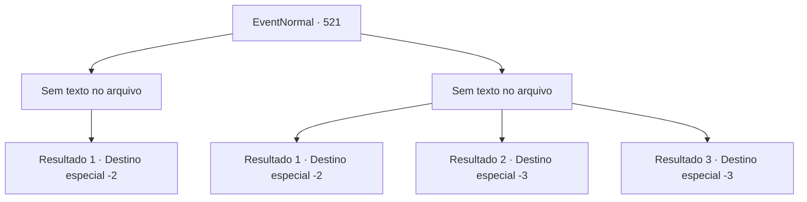

# Eventos normais · 521

[Índice da tabela](index.md) · [Índice geral](../index.md)

ID: `pt:EventNormal:521` · Fonte: `EventNormal4` · Versão: 1.2.47.

Mapeamento estático dos arquivos; a disponibilidade e a execução dependem do estado da run.

## Texto do evento

*Sem texto no arquivo.*

## Dados de entrada

```json
{
  "id": 521,
  "grade": 1,
  "place": "",
  "required": ""
}
```

## Mapa das escolhas



## Escolhas e resultados

### Escolha 1

*Sem texto no arquivo; o papel dessa opção depende da interface do jogo.*

Requisitos e outros campos da escolha:

```json
{
  "required": ""
}
```

#### Resultado 1.1

Com toda a sua força, você golpeou o núcleo do Pudim Negro, destruindo-o. Com a destruição do núcleo, a forma gelatinosa da criatura desmoronou completamente. Entre os restos do Pudim Negro, você viu uma foice feita de prata. Provavelmente era a arma de alguém que tinha sido devorado pelo Pudim Negro. Você pegou a arma e seguiu em frente, evitando os resquícios corrosivos ao seu redor. Conforme o túnel chegava ao fim, um céu azul se abriu diante dos seus olhos.

Continuação registrada: [Destino especial `-2`](../destinos-especiais.md).

```json
{
  "required": "",
  "chance": "1",
  "nextEvent": -2,
  "type": 2,
  "reward": "3_160_1|5_488_10"
}
```

### Escolha 2

*Sem texto no arquivo; o papel dessa opção depende da interface do jogo.*

Requisitos e outros campos da escolha:

```json
{
  "required": ""
}
```

#### Resultado 2.1

Você não conseguiu derrotar o Pudim Negro e decidiu fugir. Felizmente, o Pudim Negro não te perseguiu e escondeu-se em busca de outra presa.

Continuação registrada: [Destino especial `-2`](../destinos-especiais.md).

```json
{
  "required": "1_0_2|1_1_2",
  "chance": "1",
  "nextEvent": -2,
  "type": 2,
  "reward": "0_0_-1|0_1_-1|5_488_10"
}
```

#### Resultado 2.2

O Pudim Negro é um monstro que aparece em lugares escuros e úmidos, atuando como um 'faxineiro' que devora tudo em seu caminho. Infelizmente, você foi engolido pelo Pudim Negro e acabou sendo 'limpo' por ele.

Continuação registrada: [Destino especial `-3`](../destinos-especiais.md).

```json
{
  "required": "2_0_2",
  "chance": "1",
  "nextEvent": -3,
  "type": 2,
  "reward": "0_0_-1|0_1_-1"
}
```

#### Resultado 2.3

O Pudim Negro é um monstro que aparece em lugares escuros e úmidos, atuando como um 'faxineiro' que devora tudo em seu caminho. Infelizmente, você foi engolido pelo Pudim Negro e acabou sendo 'limpo' por ele.

Continuação registrada: [Destino especial `-3`](../destinos-especiais.md).

```json
{
  "required": "2_1_2",
  "chance": "1",
  "nextEvent": -3,
  "type": 2,
  "reward": "0_0_-1|0_1_-1"
}
```

## Referências que chegam a este evento

- [Evento 520 · escolha 1 · resultado 1](0520.md#escolha-1)
- [Evento 520 · escolha 2 · resultado 2](0520.md#escolha-2)
- [Evento 520 · escolha 3 · resultado 1](0520.md#escolha-3)
