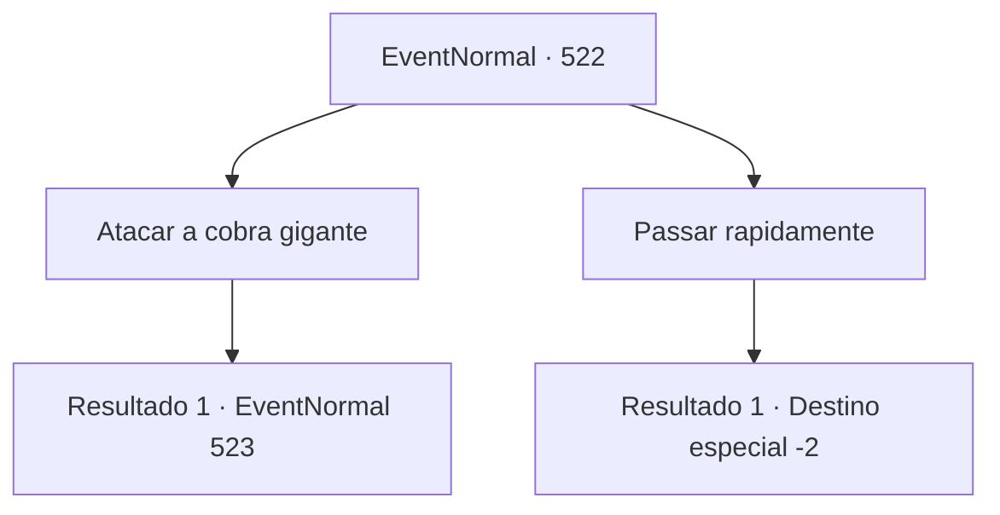

# Eventos normais · 522

[Índice da tabela](index.md) · [Índice geral](../index.md)

ID: `pt:EventNormal:522` · Fonte: `EventNormal4` · Versão: 1.2.47.

Mapeamento estático dos arquivos; a disponibilidade e a execução dependem do estado da run.

## Texto do evento

*Sem texto no arquivo.*

## Dados de entrada

```json
{
  "id": 522,
  "grade": 1,
  "place": "",
  "required": ""
}
```

## Mapa das escolhas



## Escolhas e resultados

### Escolha 1

Atacar a cobra gigante

Requisitos e outros campos da escolha:

```json
{
  "required": ""
}
```

#### Resultado 1.1

Você rapidamente sacou sua arma e atacou a cobra gigante. A cobra gigante retaliou, projetando veneno gotejante em sua direção com suas presas.

Continuação registrada: [Evento 523](0523.md) na mesma tabela.

```json
{
  "required": "",
  "chance": "1",
  "nextEvent": 523,
  "type": 2,
  "reward": "6_0_63",
  "place": 1
}
```

### Escolha 2

Passar rapidamente

Requisitos e outros campos da escolha:

```json
{
  "required": ""
}
```

#### Resultado 2.1

Enquanto viajava, você passou rapidamente por aquele lugar enquanto os viajantes eram devorados. A gigantesca cobra, ocupada com sua refeição, não se importou com a sua passagem. <link=shake><color=red>

 "Ah!!"

</color></link> Os terríveis gritos dos viajantes ecoaram pela montanha.

Continuação registrada: [Destino especial `-2`](../destinos-especiais.md).

```json
{
  "required": "",
  "chance": "1",
  "nextEvent": -2,
  "type": 2,
  "reward": "0_3_-1|5_488_10"
}
```

## Referências que chegam a este evento

- [Evento 519 · escolha 2 · resultado 1](0519.md#escolha-2)
