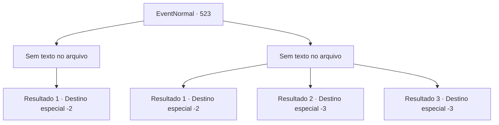

# Eventos normais · 523

[Índice da tabela](index.md) · [Índice geral](../index.md)

ID: `pt:EventNormal:523` · Fonte: `EventNormal4` · Versão: 1.2.47.

Mapeamento estático dos arquivos; a disponibilidade e a execução dependem do estado da run.

## Texto do evento

*Sem texto no arquivo.*

## Dados de entrada

```json
{
  "id": 523,
  "grade": 1,
  "place": "",
  "required": ""
}
```

## Mapa das escolhas



## Escolhas e resultados

### Escolha 1

*Sem texto no arquivo; o papel dessa opção depende da interface do jogo.*

Requisitos e outros campos da escolha:

```json
{
  "required": ""
}
```

#### Resultado 1.1

Você pegou a cabeça da gigantesca cobra caída no chão. A cobra gigante não reagiu de forma alguma. 

 "Obrigado por me ajudar."

 Após a batalha, o viajante que quase foi devorado se aproximou e agradeceu, entregando-lhe uma poção. Você guardou a poção recebida do viajante e continuou sua jornada.

Continuação registrada: [Destino especial `-2`](../destinos-especiais.md).

```json
{
  "required": "",
  "chance": "1",
  "nextEvent": -2,
  "type": 2,
  "reward": "3_36_1|3_37_1|5_488_10"
}
```

### Escolha 2

*Sem texto no arquivo; o papel dessa opção depende da interface do jogo.*

Requisitos e outros campos da escolha:

```json
{
  "required": ""
}
```

#### Resultado 2.1

Você foi derrotado pela gigantesca cobra e conseguiu escapar com vida. A cobra gigante não te perseguiu e se concentrou em devorar o viajante que ela estava segurando.

Continuação registrada: [Destino especial `-2`](../destinos-especiais.md).

```json
{
  "required": "1_0_2|1_1_2",
  "chance": "1",
  "nextEvent": -2,
  "type": 2,
  "reward": "0_0_-1|0_1_-1|5_488_10"
}
```

#### Resultado 2.2

Você foi mordido pela gigantesca cobra e o veneno se infiltrou em seu corpo. Sua consciência ficou turva e seu corpo parou de se mover. Assim, você acabou se tornando a refeição da cobra gigante, em vez do viajante.

Continuação registrada: [Destino especial `-3`](../destinos-especiais.md).

```json
{
  "required": "2_0_2",
  "chance": "1",
  "nextEvent": -3,
  "type": 2,
  "reward": "0_0_-1|0_1_-1"
}
```

#### Resultado 2.3

O seu corpo foi injetado com o veneno da gigantesca cobra. A sua consciência ficou turva e o seu corpo não conseguia mais se mover. Assim, você acabou se tornando a refeição da gigantesca cobra, em vez do viajante.

Continuação registrada: [Destino especial `-3`](../destinos-especiais.md).

```json
{
  "required": "2_1_2",
  "chance": "1",
  "nextEvent": -3,
  "type": 2,
  "reward": "0_0_-1|0_1_-1"
}
```

## Referências que chegam a este evento

- [Evento 522 · escolha 1 · resultado 1](0522.md#escolha-1)
