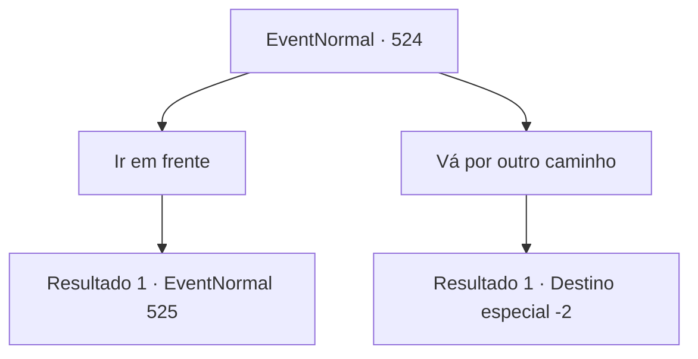

# Eventos normais · 524

[Índice da tabela](index.md) · [Índice geral](../index.md)

ID: `pt:EventNormal:524` · Fonte: `EventNormal4` · Versão: 1.2.47.

Mapeamento estático dos arquivos; a disponibilidade e a execução dependem do estado da run.

## Texto do evento

O sol quente penetrava pelas folhas enquanto você se dirigia para a entrada da montanha. Viajantes que passavam por você se aproximaram animadamente, falando alto. 

 "Ei, olhem só, é um rosto que não costumamos ver por aqui. Tenham cuidado. Há um grifo vivendo nesta montanha!"

 "Haha! Se por acaso você conseguir capturar o grifo, vá encontrar o Visconde Brandon de Walter Castle. Dizem que ele está disposto a pagar um preço alto pelo corpo do grifo!"

 Com suas palavras lançadas casualmente, eles se afastaram.

## Dados de entrada

```json
{
  "id": 524,
  "grade": 1,
  "place": "",
  "required": "5_490_0"
}
```

## Mapa das escolhas



## Escolhas e resultados

### Escolha 1

Ir em frente

Requisitos e outros campos da escolha:

```json
{
  "required": ""
}
```

#### Resultado 1.1

Ao atravessar a entrada da montanha, surge um declive íngreme e um riacho murmurante. Você começa a subir a montanha lentamente ao longo do riacho. A cada passo, seus tornozelos ficam tensos, e o sol quente fica cada vez mais forte. O suor na sua testa escorre pelo seu rosto.

 'Clink, clink.'

 Você vira a cabeça para o som estranho de ferro batendo contra pedra. O som o leva a encontrar um grifo lutando em uma armadilha para urso.

Continuação registrada: [Evento 525](0525.md) na mesma tabela.

```json
{
  "required": "",
  "chance": "1",
  "nextEvent": 525,
  "type": 2,
  "reward": ""
}
```

### Escolha 2

Vá por outro caminho

Requisitos e outros campos da escolha:

```json
{
  "required": ""
}
```

#### Resultado 2.1

Você escolheu um caminho diferente com medo de encontrar o Grifo. E felizmente, você não o encontra.

Continuação registrada: [Destino especial `-2`](../destinos-especiais.md).

```json
{
  "required": "",
  "chance": "1",
  "nextEvent": -2,
  "type": 2,
  "reward": "5_490_10"
}
```

## Referências que chegam a este evento

Nenhum `nextEvent` positivo da mesma tabela aponta para este nó. Isso não prova que seja inacessível: sorteio e estado de história podem selecioná-lo.

