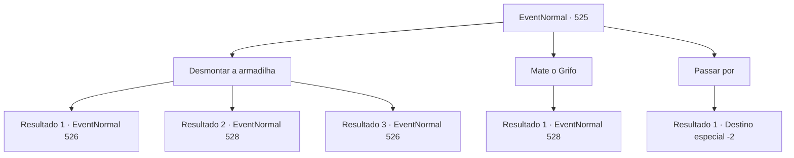

# Eventos normais · 525

[Índice da tabela](index.md) · [Índice geral](../index.md)

ID: `pt:EventNormal:525` · Fonte: `EventNormal4` · Versão: 1.2.47.

Mapeamento estático dos arquivos; a disponibilidade e a execução dependem do estado da run.

## Texto do evento

*Sem texto no arquivo.*

## Dados de entrada

```json
{
  "id": 525,
  "grade": 1,
  "place": "",
  "required": ""
}
```

## Mapa das escolhas



## Escolhas e resultados

### Escolha 1

Desmontar a armadilha

Requisitos e outros campos da escolha:

```json
{
  "required": ""
}
```

#### Resultado 1.1

Você se aproxima cuidadosamente do Grifo para verificar sua condição. Uma armadilha para urso, com a boca firmemente fechada, está cravada na pata esquerda do Grifo. Você toca a armadilha para urso com cuidado. A estrutura da armadilha é simples, então não é difícil desmontá-la. Ao desmontar a armadilha para urso, o Grifo, olhando para você, voa alto para o céu. Nesse momento, um homem surge dos arbustos. 

 "Ei! Você soltou o Grifo da armadilha?"

 O homem está vestido com uma armadura de couro bem cuidada e tem várias armas presas às costas, incluindo uma espada, uma lança e um arco. Ele te encara com olhos furiosos. 

 "Como você ousa soltar minha presa? Como vai assumir a responsabilidade por isso?"


Continuação registrada: [Evento 526](0526.md) na mesma tabela.

```json
{
  "required": "10_41_1",
  "chance": "1|0_6_1",
  "nextEvent": 526,
  "type": 0,
  "reward": "0_3_1"
}
```

#### Resultado 1.2

Você se aproxima cuidadosamente do Grifo para verificar sua condição. Uma armadilha para urso, com a boca firmemente fechada, está cravada na pata esquerda do Grifo. A estrutura da armadilha parece simples, mas você não consegue desmontá-la. Ela se fecha ainda mais, apertando ainda mais, devido à sua desatenção. O Grifo grita de dor e golpeia você com suas garras.

Continuação registrada: [Evento 528](0528.md) na mesma tabela.

```json
{
  "required": "10_41_1",
  "chance": "13",
  "nextEvent": 528,
  "type": 1,
  "reward": "6_2_53",
  "place": 1
}
```

#### Resultado 1.3

Você se aproxima cuidadosamente do Grifo para verificar sua condição. Uma armadilha para urso, com a boca firmemente fechada, está cravada na pata esquerda do Grifo. Você examina a armadilha para urso com cuidado. A estrutura da armadilha é simples, então não é difícil desmontá-la. Ao desmontar a armadilha para urso, o Grifo, olhando para você, voa alto para o céu. Nesse momento, um homem surge dos arbustos. 

 "Ei! Você soltou o Grifo da armadilha?"

 O homem está vestido com uma armadura de couro bem cuidada e tem várias armas presas às costas, incluindo uma espada, uma lança e um arco. Ele te encara com olhos furiosos. 

 "Como você ousa soltar minha presa? Como vai assumir a responsabilidade por isso?"


Continuação registrada: [Evento 526](0526.md) na mesma tabela.

```json
{
  "required": "8_41_1",
  "chance": "1",
  "nextEvent": 526,
  "type": 2,
  "reward": "0_3_1|4_41_1"
}
```

### Escolha 2

Mate o Grifo

Requisitos e outros campos da escolha:

```json
{
  "required": ""
}
```

#### Resultado 2.1

Você puxa sua arma e se aproxima lentamente do Grifo. A criatura valente percebe suas intenções e imediatamente abaixa o corpo, se preparando para o ataque. Logo depois, o grito ameaçador do Grifo ecoa pelas montanhas.

Continuação registrada: [Evento 528](0528.md) na mesma tabela.

```json
{
  "required": "",
  "chance": "1",
  "nextEvent": 528,
  "type": 2,
  "reward": "6_2_53",
  "place": 1
}
```

### Escolha 3

Passar por

Requisitos e outros campos da escolha:

```json
{
  "required": ""
}
```

#### Resultado 3.1

Você passa pelo Grifo como se não o tivesse visto. Você ouve o Grifo se esforçando para se libertar enquanto se afasta.

Continuação registrada: [Destino especial `-2`](../destinos-especiais.md).

```json
{
  "required": "",
  "chance": "1",
  "nextEvent": -2,
  "type": 2,
  "reward": "5_490_10"
}
```

## Referências que chegam a este evento

- [Evento 524 · escolha 1 · resultado 1](0524.md#escolha-1)
