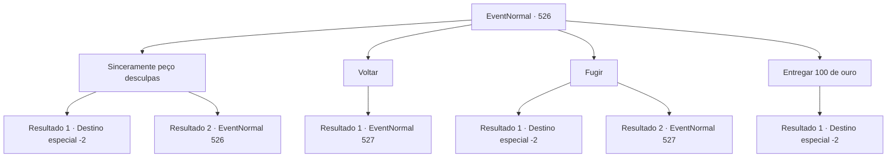

# Eventos normais · 526

[Índice da tabela](index.md) · [Índice geral](../index.md)

ID: `pt:EventNormal:526` · Fonte: `EventNormal4` · Versão: 1.2.47.

Mapeamento estático dos arquivos; a disponibilidade e a execução dependem do estado da run.

## Texto do evento

*Sem texto no arquivo.*

## Dados de entrada

```json
{
  "id": 526,
  "grade": 1,
  "place": "",
  "required": ""
}
```

## Mapa das escolhas



## Escolhas e resultados

### Escolha 1

Sinceramente peço desculpas

Requisitos e outros campos da escolha:

```json
{
  "required": "5_491_0"
}
```

#### Resultado 1.1

Você se desculpa educadamente com ele. O homem estala a língua em sua sincera desculpa como se não pudesse evitar. 

 "Huh! Não mexa nas armadilhas dos outros da próxima vez."

 O homem lança um olhar descontente para você e desaparece entre os arbustos.

Continuação registrada: [Destino especial `-2`](../destinos-especiais.md).

```json
{
  "required": "",
  "chance": "1|0_12_1",
  "nextEvent": -2,
  "type": 0,
  "reward": "5_490_10"
}
```

#### Resultado 1.2

Você se desculpa educadamente com ele. Mas o homem ainda não parece satisfeito. 

 "Não é algo que se resolva com um pedido de desculpas. Você sabe quanto aquela criatura vale? Me dê pelo menos 100 moedas de ouro!"

 A voz alta do homem ecoa pelas montanhas ao seu redor.

Continuação registrada: [Evento 526](0526.md) na mesma tabela.

```json
{
  "required": "",
  "chance": "15",
  "nextEvent": 526,
  "type": 1,
  "reward": "5_491_1"
}
```

### Escolha 2

Voltar

Requisitos e outros campos da escolha:

```json
{
  "required": "18_491_1"
}
```

#### Resultado 2.1

Você ousadamente diz que não sabe. Diante da sua desculpa, o homem puxa uma faca das costas e avança rosnando. 

 "Parece que preciso lhe ensinar alguns modos!"

 O homem desfere um golpe furioso com a faca em sua direção.

Continuação registrada: [Evento 527](0527.md) na mesma tabela.

```json
{
  "required": "",
  "chance": "1",
  "nextEvent": 527,
  "type": 2,
  "reward": "6_0_62",
  "place": 1
}
```

### Escolha 3

Fugir

Requisitos e outros campos da escolha:

```json
{
  "required": ""
}
```

#### Resultado 3.1

Você finge dizer algo, mas então foge rapidamente. O homem corre atrás de você, mas as armas dele o atrasam, então ele desiste. 

 "Seu maldito!"

 O grito furioso do homem ecoa pelas montanhas.

Continuação registrada: [Destino especial `-2`](../destinos-especiais.md).

```json
{
  "required": "",
  "chance": "1|0_6_1",
  "nextEvent": -2,
  "type": 0,
  "reward": "5_490_10"
}
```

#### Resultado 3.2

Você finge dizer algo, mas então foge rapidamente. No entanto, a perseguição não dura muito. O homem que rapidamente te seguiu o alcança e agarra você. 

 "Parece que eu preciso te dar uma lição!"

 O homem te joga no chão, então violentamente saca uma faca das costas dele. O homem furioso brande a faca na sua direção.

Continuação registrada: [Evento 527](0527.md) na mesma tabela.

```json
{
  "required": "",
  "chance": "15",
  "nextEvent": 527,
  "type": 1,
  "reward": "6_0_62",
  "place": 1
}
```

### Escolha 4

Entregar 100 de ouro

Requisitos e outros campos da escolha:

```json
{
  "required": "5_491_1|1_4_100"
}
```

#### Resultado 4.1

Você entrega 100 moedas de ouro ao homem como um pedido de desculpas. O homem conta as moedas, uma por uma, estala a língua e as guarda. 

 "Huh! Não mexa nas armadilhas dos outros da próxima vez."

 O homem lança um olhar descontente para você e desaparece entre os arbustos.

Continuação registrada: [Destino especial `-2`](../destinos-especiais.md).

```json
{
  "required": "",
  "chance": "1",
  "nextEvent": -2,
  "type": 2,
  "reward": "0_4_-100|5_490_10"
}
```

## Referências que chegam a este evento

- [Evento 525 · escolha 1 · resultado 1](0525.md#escolha-1)
- [Evento 525 · escolha 1 · resultado 3](0525.md#escolha-1)
- [Evento 526 · escolha 1 · resultado 2](0526.md#escolha-1)
