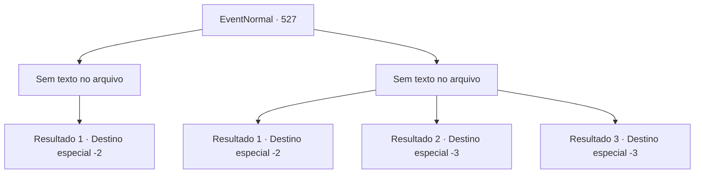

# Eventos normais · 527

[Índice da tabela](index.md) · [Índice geral](../index.md)

ID: `pt:EventNormal:527` · Fonte: `EventNormal4` · Versão: 1.2.47.

Mapeamento estático dos arquivos; a disponibilidade e a execução dependem do estado da run.

## Texto do evento

*Sem texto no arquivo.*

## Dados de entrada

```json
{
  "id": 527,
  "grade": 1,
  "place": "",
  "required": ""
}
```

## Mapa das escolhas



## Escolhas e resultados

### Escolha 1

*Sem texto no arquivo; o papel dessa opção depende da interface do jogo.*

Requisitos e outros campos da escolha:

```json
{
  "required": ""
}
```

#### Resultado 1.1

Você derruba o homem e segue em frente. Derrotado, ele geme sem se levantar.

Continuação registrada: [Destino especial `-2`](../destinos-especiais.md).

```json
{
  "required": "",
  "chance": "1",
  "nextEvent": -2,
  "type": 2,
  "reward": "5_490_10"
}
```

### Escolha 2

*Sem texto no arquivo; o papel dessa opção depende da interface do jogo.*

Requisitos e outros campos da escolha:

```json
{
  "required": ""
}
```

#### Resultado 2.1

O homem era um aventureiro experiente, destemido em batalha. Uma vez que ele começasse a lutar, ele não mostrava piedade ao seu oponente, e você, sendo empurrado para trás constantemente, acabou fugindo. 

 "Vamos, me dê mais uma chance! Vou quebrar sua coluna dessa vez!"

 O grito furioso do homem ecoou pelas montanhas com força.

Continuação registrada: [Destino especial `-2`](../destinos-especiais.md).

```json
{
  "required": "1_0_2|1_1_2",
  "chance": "1",
  "nextEvent": -2,
  "type": 2,
  "reward": "0_0_-1|0_1_-1|5_490_10"
}
```

#### Resultado 2.2

O homem era um aventureiro experiente, implacável em combate. Uma vez que ele começasse a lutar, não mostrava piedade ao seu oponente, e seus ataques continuaram até você estar à beira da morte. 

 "Onde você está se escondendo..."

 A dor ardente, o cheiro de sangue e a voz irritada do homem se perderam na escuridão profunda.

Continuação registrada: [Destino especial `-3`](../destinos-especiais.md).

```json
{
  "required": "2_0_2",
  "chance": "1",
  "nextEvent": -3,
  "type": 2,
  "reward": "0_0_-1|0_1_-1"
}
```

#### Resultado 2.3

O homem era um aventureiro experiente e implacável em combate. Ele não mostrava piedade para o oponente uma vez que a luta começasse, e seus ataques continuaram até você estar à beira da morte. 

 "Onde você está se escondendo..."

 A sensação ardente de dor, o cheiro de sangue e a voz irritada do homem afundaram na escuridão profunda.

Continuação registrada: [Destino especial `-3`](../destinos-especiais.md).

```json
{
  "required": "2_1_2",
  "chance": "1",
  "nextEvent": -3,
  "type": 2,
  "reward": "0_0_-1|0_1_-1"
}
```

## Referências que chegam a este evento

- [Evento 526 · escolha 2 · resultado 1](0526.md#escolha-2)
- [Evento 526 · escolha 3 · resultado 2](0526.md#escolha-3)
