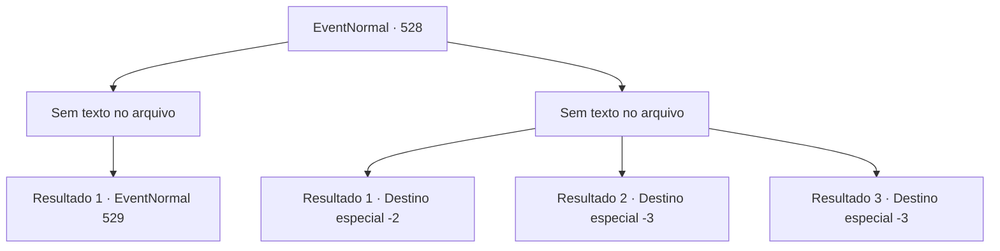

# Eventos normais · 528

[Índice da tabela](index.md) · [Índice geral](../index.md)

ID: `pt:EventNormal:528` · Fonte: `EventNormal4` · Versão: 1.2.47.

Mapeamento estático dos arquivos; a disponibilidade e a execução dependem do estado da run.

## Texto do evento

*Sem texto no arquivo.*

## Dados de entrada

```json
{
  "id": 528,
  "grade": 1,
  "place": "",
  "required": ""
}
```

## Mapa das escolhas



## Escolhas e resultados

### Escolha 1

*Sem texto no arquivo; o papel dessa opção depende da interface do jogo.*

Requisitos e outros campos da escolha:

```json
{
  "required": ""
}
```

#### Resultado 1.1

Você avaliou cuidadosamente o corpo do grifo enquanto respirava fundo. Se você levasse esse corpo para o Conde Brandon, certamente poderia ganhar uma quantia considerável. 

 "Oh! O grifo!?"

 Nesse momento, um homem de meia-idade emergiu dos arbustos. Ele usava uma armadura de couro bem cuidada e carregava várias armas nas costas, incluindo espadas, lanças e um arco. O homem alternou seu olhar entre você e o grifo e fez um pigarro antes de falar. 

 "Hmm! Esse grifo. Não estava preso em uma armadilha? Essa era a armadilha que eu coloquei para capturá-lo. Parece que você o matou... Mas, graças à minha armadilha, a posse desse corpo é legítima para mim."


Continuação registrada: [Evento 529](0529.md) na mesma tabela.

```json
{
  "required": "",
  "chance": "1",
  "nextEvent": 529,
  "type": 2,
  "reward": ""
}
```

### Escolha 2

*Sem texto no arquivo; o papel dessa opção depende da interface do jogo.*

Requisitos e outros campos da escolha:

```json
{
  "required": ""
}
```

#### Resultado 2.1

O gigantesco corpo do grifo colidiu com você. Você recebeu um grande impacto e cambaleou, rolando ao longo da encosta íngreme.

Continuação registrada: [Destino especial `-2`](../destinos-especiais.md).

```json
{
  "required": "1_0_2|1_1_2",
  "chance": "1",
  "nextEvent": -2,
  "type": 2,
  "reward": "0_0_-1|0_1_-1|5_490_10"
}
```

#### Resultado 2.2

O enorme corpo do grifo colidiu com você. Você sofreu um impacto forte e cambaleou, rolando pelo caminho íngreme. Não demorou muito até que um som abrupto 'buuum!' ecoasse, e a morte chegou até você.

Continuação registrada: [Destino especial `-3`](../destinos-especiais.md).

```json
{
  "required": "2_0_2",
  "chance": "1",
  "nextEvent": -3,
  "type": 2,
  "reward": "0_0_-1|0_1_-1"
}
```

#### Resultado 2.3

O enorme corpo do grifo colidiu com você. Você sofreu um impacto forte e cambaleou, rolando pelo caminho íngreme. Não demorou muito até que um som abrupto 'buuum!' ecoasse, e a morte chegou até você.

Continuação registrada: [Destino especial `-3`](../destinos-especiais.md).

```json
{
  "required": "2_1_2",
  "chance": "1",
  "nextEvent": -3,
  "type": 2,
  "reward": "0_0_-1|0_1_-1"
}
```

## Referências que chegam a este evento

- [Evento 525 · escolha 1 · resultado 2](0525.md#escolha-1)
- [Evento 525 · escolha 2 · resultado 1](0525.md#escolha-2)
