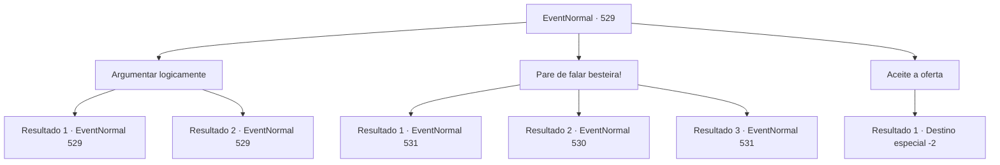

# Eventos normais · 529

[Índice da tabela](index.md) · [Índice geral](../index.md)

ID: `pt:EventNormal:529` · Fonte: `EventNormal4` · Versão: 1.2.47.

Mapeamento estático dos arquivos; a disponibilidade e a execução dependem do estado da run.

## Texto do evento

*Sem texto no arquivo.*

## Dados de entrada

```json
{
  "id": 529,
  "grade": 1,
  "place": "",
  "required": ""
}
```

## Mapa das escolhas



## Escolhas e resultados

### Escolha 1

Argumentar logicamente

Requisitos e outros campos da escolha:

```json
{
  "required": "5_492_0"
}
```

#### Resultado 1.1

Você refutou logicamente a afirmação do homem. Por mais que ele tenha armado a armadilha, não seria razoável que ele ficasse com o corpo do grifo. Em resposta à sua refutação, o homem ponderou por um momento e apresentou uma nova proposta. 

 "E que tal isso? Dizem que um tal Conde Brandon está disposto a pagar um alto preço pelo corpo do grifo. E se nós o vendermos juntos e dividirmos o valor pela metade?"


Continuação registrada: [Evento 529](0529.md) na mesma tabela.

```json
{
  "required": "",
  "chance": "1|0_7_1",
  "nextEvent": 529,
  "type": 0,
  "reward": "5_492_1"
}
```

#### Resultado 1.2

Você tentou refutar a afirmação do homem, mas acabou gaguejando e parando no meio da frase. Diante da sua resposta hesitante, o homem balançou a cabeça com desprezo. 

 "Não seja ganancioso, apenas me entregue. Então, não haverá problemas"


Continuação registrada: [Evento 529](0529.md) na mesma tabela.

```json
{
  "required": "",
  "chance": "15",
  "nextEvent": 529,
  "type": 1,
  "reward": "5_492_2"
}
```

### Escolha 2

Pare de falar besteira!

Requisitos e outros campos da escolha:

```json
{
  "required": ""
}
```

#### Resultado 2.1

Você gritou para o homem parar com suas bobagens e ir embora. Diante da sua ameaça agressiva, o homem ficou visivelmente perturbado e deu alguns passos para trás. 

 "Maldição! Só tenho azar!"

 Ele recuou cautelosamente e acabou virando as costas para fugir. Assim que você confirmou que ele se foi, carregou o corpo do grifo e seguiu em direção ao Castelo de Walter.

 Algum tempo depois, ao chegar ao Castelo de Walter, você procurou pelo Conde Brandon e mostrou o corpo do grifo. O Conde Brandon estava emocionado e imediatamente estendeu uma bolsa de ouro na sua direção. 

 "Este é realmente um grifo magnífico! Por favor, venda-me esse corpo!"

 A bolsa continha 150 moedas de ouro.

Continuação registrada: [Evento 531](0531.md) na mesma tabela.

```json
{
  "required": "21_1_2",
  "chance": "1|0_12_1",
  "nextEvent": 531,
  "type": 0,
  "reward": ""
}
```

#### Resultado 2.2

Você gritou para o homem ir embora e parar com as bobagens. Diante do seu grito ameaçador, o homem pareceu surpreso e confuso, mas então sacou a espada das costas. 

 "Parece que você precisa de uma lição para recuperar o juízo!"

 A espada furiosa do homem foi brandida em sua direção.

Continuação registrada: [Evento 530](0530.md) na mesma tabela.

```json
{
  "required": "21_1_2",
  "chance": "15",
  "nextEvent": 530,
  "type": 1,
  "reward": "6_0_62",
  "place": 1
}
```

#### Resultado 2.3

Você gritou para o homem ir embora e parar com as bobagens. Diante de sua ameaça agressiva, o homem ficou visivelmente pálido e recuou lentamente. 

 "Maldição! Parece que sou azarado!"

 Com cuidado, ele recuou e finalmente virou as costas para fugir. Assim que você confirmou que ele se foi, carregou o corpo do grifo e seguiu em direção ao Castelo de Walter.

 Pouco tempo depois, ao chegar ao Castelo de Walter, você procurou pelo Conde Brandon e mostrou o corpo do grifo. O Conde Brandon estava com o rosto emocionado e estendeu uma bolsa de ouro abertamente. 

 "É realmente um grifo magnífico! Por favor, venda-me esse corpo!"

 A bolsa continha 150 moedas de ouro.

Continuação registrada: [Evento 531](0531.md) na mesma tabela.

```json
{
  "required": "20_1_2",
  "chance": "1",
  "nextEvent": 531,
  "type": 2,
  "reward": ""
}
```

### Escolha 3

Aceite a oferta

Requisitos e outros campos da escolha:

```json
{
  "required": "5_492_1"
}
```

#### Resultado 3.1

Você aceitou a proposta e seguiu em direção ao Castelo de Walter, onde o Conde Brandon estava interessado em comprar o corpo do grifo.

 Algum tempo depois, você e o homem chegaram ao Castelo de Walter e procuraram pelo Conde Brandon. Quando o Conde Brandon viu o corpo do grifo, ele ficou extremamente feliz e entregou 150 moedas de ouro. Após dividirem a recompensa igualmente, vocês se separaram e seguiram caminhos diferentes.

Continuação registrada: [Destino especial `-2`](../destinos-especiais.md).

```json
{
  "required": "",
  "chance": "1",
  "nextEvent": -2,
  "type": 2,
  "reward": "0_4_75|5_490_10"
}
```

## Referências que chegam a este evento

- [Evento 528 · escolha 1 · resultado 1](0528.md#escolha-1)
- [Evento 529 · escolha 1 · resultado 1](0529.md#escolha-1)
- [Evento 529 · escolha 1 · resultado 2](0529.md#escolha-1)
