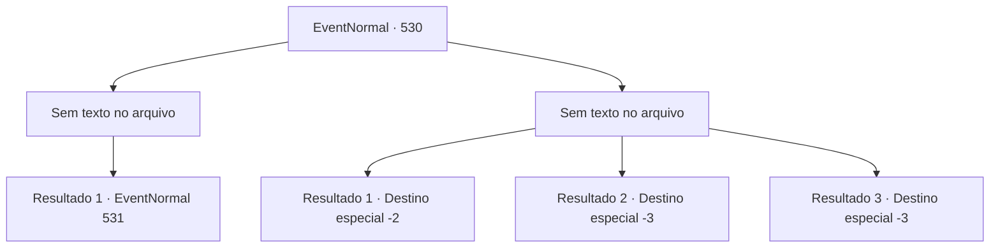

# Eventos normais · 530

[Índice da tabela](index.md) · [Índice geral](../index.md)

ID: `pt:EventNormal:530` · Fonte: `EventNormal4` · Versão: 1.2.47.

Mapeamento estático dos arquivos; a disponibilidade e a execução dependem do estado da run.

## Texto do evento

*Sem texto no arquivo.*

## Dados de entrada

```json
{
  "id": 530,
  "grade": 1,
  "place": "",
  "required": ""
}
```

## Mapa das escolhas



## Escolhas e resultados

### Escolha 1

*Sem texto no arquivo; o papel dessa opção depende da interface do jogo.*

Requisitos e outros campos da escolha:

```json
{
  "required": ""
}
```

#### Resultado 1.1

O homem derrotado gemia de dor no chão, incapaz de se levantar. Você tirou os olhos dele, você pegou o corpo do grifo e partiu em direção ao Castelo de Walter.

 Após um curto período, você chegou ao Castelo de Walter e procurou pelo Conde Brandon, mostrando o corpo do grifo. O Conde Brandon estava com o rosto animado enquanto estendia uma bolsa de ouro aberta. 

 "Verdadeiramente magnífico grifo! Por favor, venda-me esse corpo!"

 A bolsa continha 150 moedas de ouro.

Continuação registrada: [Evento 531](0531.md) na mesma tabela.

```json
{
  "required": "",
  "chance": "1",
  "nextEvent": 531,
  "type": 2,
  "reward": ""
}
```

### Escolha 2

*Sem texto no arquivo; o papel dessa opção depende da interface do jogo.*

Requisitos e outros campos da escolha:

```json
{
  "required": ""
}
```

#### Resultado 2.1

O homem derrotado era um aventureiro destemido. Ele não permitia que seu oponente escapasse uma vez que a luta começava, e enquanto você era continuamente pressionado, acabou fugindo. 

 "Vamos, tente mais uma vez! Vou fazer você se contorcer de dor dessa vez!"

 O grito furioso do homem ressoou pelas montanhas.

Continuação registrada: [Destino especial `-2`](../destinos-especiais.md).

```json
{
  "required": "1_0_2|1_1_2",
  "chance": "1",
  "nextEvent": -2,
  "type": 2,
  "reward": "0_0_-1|0_1_-1|5_490_10"
}
```

#### Resultado 2.2

O aventureiro derrotado era implacável em combate. Ele não dava trégua uma vez que a luta começava, e seus ataques continuaram até que você estivesse à beira da morte. 

 "Onde você está se escondendo..."

 A sensação de dor ardente, o cheiro de sangue e a voz irritada do aventureiro se dissiparam na escuridão profunda.

Continuação registrada: [Destino especial `-3`](../destinos-especiais.md).

```json
{
  "required": "2_0_2",
  "chance": "1",
  "nextEvent": -3,
  "type": 2,
  "reward": "0_0_-1|0_1_-1"
}
```

#### Resultado 2.3

O aventureiro era implacável em combate, mesmo com suas feridas. Ele não hesitava em atacar seu oponente uma vez que a luta começava, e seus ataques continuavam até que você estivesse à beira da morte. 

 "Onde você está se escondendo..."

 A sensação de dor intensa, o cheiro de sangue e a voz irritada do aventureiro se dissiparam na escuridão profunda.

Continuação registrada: [Destino especial `-3`](../destinos-especiais.md).

```json
{
  "required": "2_1_2",
  "chance": "1",
  "nextEvent": -3,
  "type": 2,
  "reward": "0_0_-1|0_1_-1"
}
```

## Referências que chegam a este evento

- [Evento 529 · escolha 2 · resultado 2](0529.md#escolha-2)
