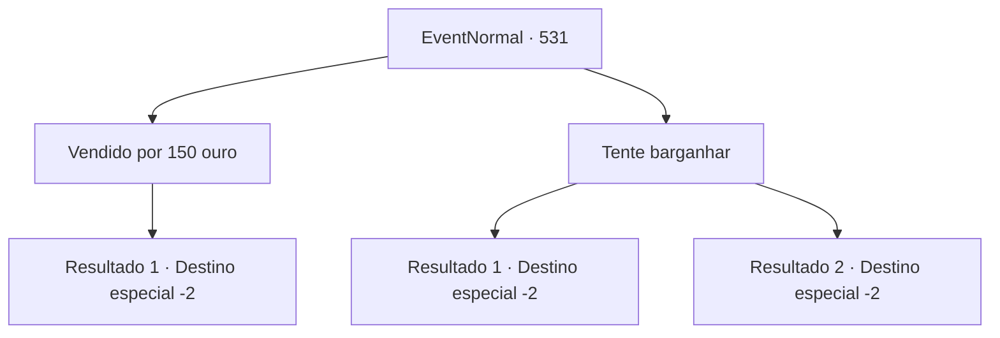

# Eventos normais · 531

[Índice da tabela](index.md) · [Índice geral](../index.md)

ID: `pt:EventNormal:531` · Fonte: `EventNormal4` · Versão: 1.2.47.

Mapeamento estático dos arquivos; a disponibilidade e a execução dependem do estado da run.

## Texto do evento

*Sem texto no arquivo.*

## Dados de entrada

```json
{
  "id": 531,
  "grade": 1,
  "place": "",
  "required": ""
}
```

## Mapa das escolhas



## Escolhas e resultados

### Escolha 1

Vendido por 150 ouro

Requisitos e outros campos da escolha:

```json
{
  "required": ""
}
```

#### Resultado 1.1

Você vendeu o corpo do grifo por 150 peças de ouro. Após a conclusão do negócio, o Visconde Brandon, com uma expressão extasiada, segurou o corpo nos braços. 

 "Oh, oh! Eu nunca imaginei que teria um grifo dos meus sonhos em minhas mãos! Veja só! Traga imediatamente o taxidermista! Vou preservar para sempre a imagem majestosa do corajoso grifo!"

 Ao grito do Visconde Brandon, os servos da mansão começaram a se mover freneticamente. Você passou pelos serviçais suados e deixou a mansão para trás.

Continuação registrada: [Destino especial `-2`](../destinos-especiais.md).

```json
{
  "required": "",
  "chance": "1",
  "nextEvent": -2,
  "type": 2,
  "reward": "0_4_150|5_490_10"
}
```

### Escolha 2

Tente barganhar

Requisitos e outros campos da escolha:

```json
{
  "required": ""
}
```

#### Resultado 2.1

Você pediu ao Visconde Brandon por mais ouro. Completamente encantado com o grifo, ele prontamente acrescentou mais 50 peças de ouro. Após a conclusão da negociação, o Visconde Brandon, com uma expressão extasiada, abraçou o corpo. 

 "Oh! Mal posso acreditar que agora tenho um grifo, como sempre sonhei! Veja só! Traga imediatamente o taxidermista! Preservarei para sempre a aparência majestosa do corajoso grifo!"

 Ao ouvirem o grito do Visconde Brandon, os servos da mansão começaram a se mover freneticamente. Você passou pelos servos suados e deixou a mansão.

Continuação registrada: [Destino especial `-2`](../destinos-especiais.md).

```json
{
  "required": "",
  "chance": "1|0_12_1",
  "nextEvent": -2,
  "type": 0,
  "reward": "0_4_200|5_490_10"
}
```

#### Resultado 2.2

Você exigiu um pouco mais de ouro ao Visconde Brandon, mas ele firmemente recusou. 

 "Hmm... Lamento, mas não posso oferecer mais de 150 peças de ouro."

 Sem opções, você acabou vendendo o corpo do grifo por 150 peças de ouro. Após a conclusão do negócio, o Visconde Brandon, com uma expressão extasiada, segurou o corpo nos braços. 

 "Oh, oh! Eu nunca imaginei que teria um grifo dos meus sonhos em minhas mãos! Veja só! Traga imediatamente o taxidermista! Vou preservar para sempre a imagem majestosa do corajoso grifo!"

 Ao grito do Visconde Brandon, os servos da mansão começaram a se mover freneticamente. Você passou pelos serviçais suados e deixou a mansão para trás.

Continuação registrada: [Destino especial `-2`](../destinos-especiais.md).

```json
{
  "required": "",
  "chance": "8",
  "nextEvent": -2,
  "type": 1,
  "reward": "0_4_150|5_490_10"
}
```

## Referências que chegam a este evento

- [Evento 529 · escolha 2 · resultado 1](0529.md#escolha-2)
- [Evento 529 · escolha 2 · resultado 3](0529.md#escolha-2)
- [Evento 530 · escolha 1 · resultado 1](0530.md#escolha-1)
