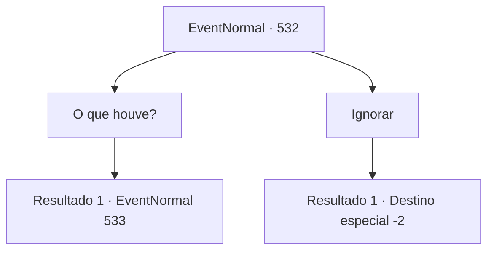

# Eventos normais · 532

[Índice da tabela](index.md) · [Índice geral](../index.md)

ID: `pt:EventNormal:532` · Fonte: `EventNormal4` · Versão: 1.2.47.

Mapeamento estático dos arquivos; a disponibilidade e a execução dependem do estado da run.

## Texto do evento

Tarde na noite, você novamente visita a cidade de 'Rom', que é famosa pelos jogos gladiatoriais. Talvez por você ter chegado no meio da noite, Rom está quieta, diferente da última vez. Você anda pelas ruas procurando um lugar para descansar. Mas então você vê uma mulher musculosa de pé na entrada do coliseu. Ela olhava inexpressiva para o céu.

## Dados de entrada

```json
{
  "id": 532,
  "grade": 1,
  "place": "",
  "required": "5_234_9"
}
```

## Mapa das escolhas



## Escolhas e resultados

### Escolha 1

O que houve?

Requisitos e outros campos da escolha:

```json
{
  "required": ""
}
```

#### Resultado 1.1

Você vai até a mulher e pergunta o que está acontecendo. Com a sua pergunta, a mulher suspira e então diz 

 "Eu sou Sandra. Uma gladiadora que trabalha aqui."

 Ela conta que é começou a ser chamada de 'Sandra Mais Forte Que Urso' depois de derrubar um urso apenas com as mãos. 

 "Três meses atrás eu peguei dinheiro emprestado com um prestamista. Foi porque meu irmão estava com uma doença séria. Mas meu débito cresceu e eu não consegui pagar."

 Sandra diz que deve um total de 300 moedas. Desses, 100 moedas eram a dívida inicial e 200 de juros. 

 "Quando eu disse que não ia conseguir pagar ele de volta, o prestamista me disse que eu deveria escolher entre ir pra prisão ou pagar com serviço.

Continuação registrada: [Evento 533](0533.md) na mesma tabela.

```json
{
  "required": "",
  "chance": "1",
  "nextEvent": 533,
  "type": 2,
  "reward": ""
}
```

### Escolha 2

Ignorar

Requisitos e outros campos da escolha:

```json
{
  "required": ""
}
```

#### Resultado 2.1

Você passa pela mulher, que suspira.

Continuação registrada: [Destino especial `-2`](../destinos-especiais.md).

```json
{
  "required": "",
  "chance": "1",
  "nextEvent": -2,
  "type": 2,
  "reward": "5_234_10"
}
```

## Referências que chegam a este evento

Nenhum `nextEvent` positivo da mesma tabela aponta para este nó. Isso não prova que seja inacessível: sorteio e estado de história podem selecioná-lo.

