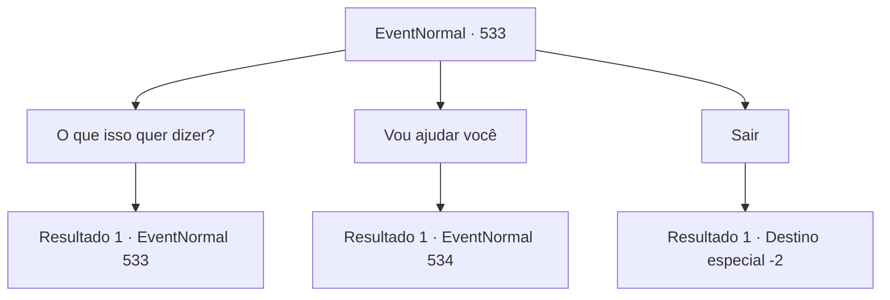

# Eventos normais · 533

[Índice da tabela](index.md) · [Índice geral](../index.md)

ID: `pt:EventNormal:533` · Fonte: `EventNormal4` · Versão: 1.2.47.

Mapeamento estático dos arquivos; a disponibilidade e a execução dependem do estado da run.

## Texto do evento

*Sem texto no arquivo.*

## Dados de entrada

```json
{
  "id": 533,
  "grade": 1,
  "place": "",
  "required": ""
}
```

## Mapa das escolhas



## Escolhas e resultados

### Escolha 1

O que isso quer dizer?

Requisitos e outros campos da escolha:

```json
{
  "required": "5_493_0"
}
```

#### Resultado 1.1

Você pergunta o que ela quis dizer com 'pagar com serviço'. Sandra responde à sua pergunta com tom de desânimo. 

 "É óbvio. Ele quer que eu participe em jogos gladiatoriais. Um evento especial que ele inventou, não um normal."

 Sandra diz que as novas regras são extremamente duras. Ela deve participar de três jogos em sequência sem desncanço e só termina se ela morrer ou vencer todas. O rosto de Sandra demonstra sentimentos variados. 

 "É uma ideia ridícula, mas eu não podia nem mesmo fugir. Ele disse que se eu fugisse, passaria a dívida ao meu irmão. Então eu aceitei e os jogos serão daqui a quatro dias."


Continuação registrada: [Evento 533](0533.md) na mesma tabela.

```json
{
  "required": "",
  "chance": "1",
  "nextEvent": 533,
  "type": 2,
  "reward": "5_493_1"
}
```

### Escolha 2

Vou ajudar você

Requisitos e outros campos da escolha:

```json
{
  "required": "5_493_1"
}
```

#### Resultado 2.1

Você diz que vai ajudar Sandra. Sandra olha para você com uma expressão de surpresa. 

 "Como você vai me ajudar?"

 O olhar questionador dela foca em você.

Continuação registrada: [Evento 534](0534.md) na mesma tabela.

```json
{
  "required": "",
  "chance": "1",
  "nextEvent": 534,
  "type": 2,
  "reward": ""
}
```

### Escolha 3

Sair

Requisitos e outros campos da escolha:

```json
{
  "required": ""
}
```

#### Resultado 3.1

Você conforta ela e depois sai silenciosamente.

Continuação registrada: [Destino especial `-2`](../destinos-especiais.md).

```json
{
  "required": "",
  "chance": "1",
  "nextEvent": -2,
  "type": 2,
  "reward": "5_234_10"
}
```

## Referências que chegam a este evento

- [Evento 532 · escolha 1 · resultado 1](0532.md#escolha-1)
- [Evento 533 · escolha 1 · resultado 1](0533.md#escolha-1)
