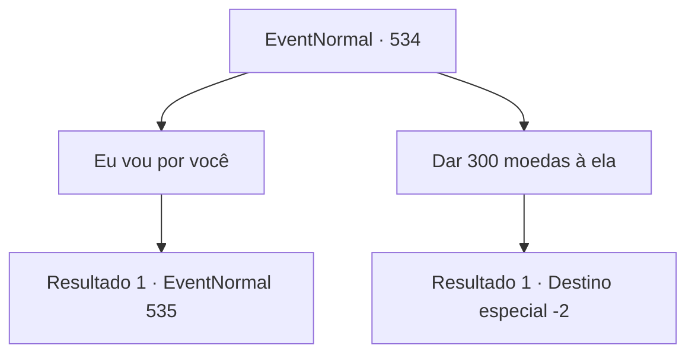

# Eventos normais · 534

[Índice da tabela](index.md) · [Índice geral](../index.md)

ID: `pt:EventNormal:534` · Fonte: `EventNormal4` · Versão: 1.2.47.

Mapeamento estático dos arquivos; a disponibilidade e a execução dependem do estado da run.

## Texto do evento

*Sem texto no arquivo.*

## Dados de entrada

```json
{
  "id": 534,
  "grade": 1,
  "place": "",
  "required": ""
}
```

## Mapa das escolhas



## Escolhas e resultados

### Escolha 1

Eu vou por você

Requisitos e outros campos da escolha:

```json
{
  "required": ""
}
```

#### Resultado 1.1

Você diz que participará do jogo por ela. Mas os olhos de Sandra continuam cheios de dúvidas. 

 "Obrigada... mas você vai morrer se não estiver pronto."

 Com um aviso discreto, Sandra olha para você, parada. Isso significa que ela quer ver você mostrar suas habilidades.

Continuação registrada: [Evento 535](0535.md) na mesma tabela.

```json
{
  "required": "",
  "chance": "1",
  "nextEvent": 535,
  "type": 2,
  "reward": ""
}
```

### Escolha 2

Dar 300 moedas à ela

Requisitos e outros campos da escolha:

```json
{
  "required": "1_4_300"
}
```

#### Resultado 2.1

Você entrega 300 moedas para Sandra. Sandra pega as moedas com mãos trêmulas e lhe dá um abraço. 

 "Oh... Oh! Obrigada! Muito obrigada! Com esse ouro, posso pagar minhas dívidas e cancelar os jogos!"

 Sandra lhe entrega a espada dela em retorno. Você sai do estádio com o presente nas suas costas.

Continuação registrada: [Destino especial `-2`](../destinos-especiais.md).

```json
{
  "required": "",
  "chance": "1",
  "nextEvent": -2,
  "type": 2,
  "reward": "0_2_1|0_4_-300|0_3_1|3_67_1|5_234_10"
}
```

## Referências que chegam a este evento

- [Evento 533 · escolha 2 · resultado 1](0533.md#escolha-2)
