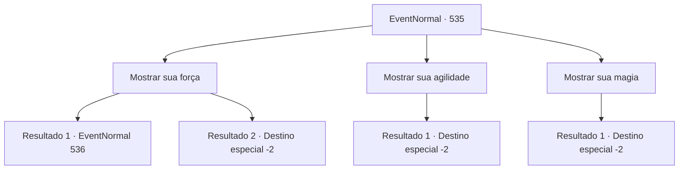

# Eventos normais · 535

[Índice da tabela](index.md) · [Índice geral](../index.md)

ID: `pt:EventNormal:535` · Fonte: `EventNormal4` · Versão: 1.2.47.

Mapeamento estático dos arquivos; a disponibilidade e a execução dependem do estado da run.

## Texto do evento

*Sem texto no arquivo.*

## Dados de entrada

```json
{
  "id": 535,
  "grade": 1,
  "place": "",
  "required": ""
}
```

## Mapa das escolhas



## Escolhas e resultados

### Escolha 1

Mostrar sua força

Requisitos e outros campos da escolha:

```json
{
  "required": ""
}
```

#### Resultado 1.1

Você ergue ela com uma mão e mostra grande força. Ela grita baixinho ao ver seu poder, depois começa a falar com voz trêmula. 

 "... Com essa força, talvez você possa mesmo vencer. Você realmente vai me ajudar?"


Continuação registrada: [Evento 536](0536.md) na mesma tabela.

```json
{
  "required": "",
  "chance": "1|0_5_1",
  "nextEvent": 536,
  "type": 0,
  "reward": ""
}
```

#### Resultado 1.2

Você pega ela pelo braço como uma demonstração de força. Mas Sandra não se move, ela só olha para você com uma cara triste. 

 "Me desculpe... mas com essa força, você vai morrer."

 Sandra, que sorri amargamente, diz que apenas aceitaria seu coração. Você se despede dela e sai de lá.

Continuação registrada: [Destino especial `-2`](../destinos-especiais.md).

```json
{
  "required": "",
  "chance": "18",
  "nextEvent": -2,
  "type": 1,
  "reward": "5_234_10"
}
```

### Escolha 2

Mostrar sua agilidade

Requisitos e outros campos da escolha:

```json
{
  "required": ""
}
```

#### Resultado 2.1

Você mostra a ela seus movimento ágeis. Sandra, que continua vendo seus movimentos, balança a cabeça com uma cara triste. 

 "Ótimo. Mas se você lutar desse jeito, eles definitivamente vão notar que não sou eu. Eu não luto desse jeito."

 Sandra, que sorri amargamente, diz que apenas aceitaria seu coração. Você se despede dela e sai de lá.

Continuação registrada: [Destino especial `-2`](../destinos-especiais.md).

```json
{
  "required": "",
  "chance": "1",
  "nextEvent": -2,
  "type": 2,
  "reward": "5_234_10"
}
```

### Escolha 3

Mostrar sua magia

Requisitos e outros campos da escolha:

```json
{
  "required": ""
}
```

#### Resultado 3.1

Você mostra a ela sua magia espalhafatosa. Sandra, que continua vendo seus movimentos, balança a cabeça com uma cara triste. 

 "Ótimo. Mas se você lutar desse jeito, eles definitivamente vão notar que não sou eu. Eu não posso usar magia."

 Sandra, que sorri amargamente, diz que apenas aceitaria seu coração. Você se despede dela e sai de lá.

Continuação registrada: [Destino especial `-2`](../destinos-especiais.md).

```json
{
  "required": "",
  "chance": "1",
  "nextEvent": -2,
  "type": 2,
  "reward": "5_234_10"
}
```

## Referências que chegam a este evento

- [Evento 534 · escolha 1 · resultado 1](0534.md#escolha-1)
