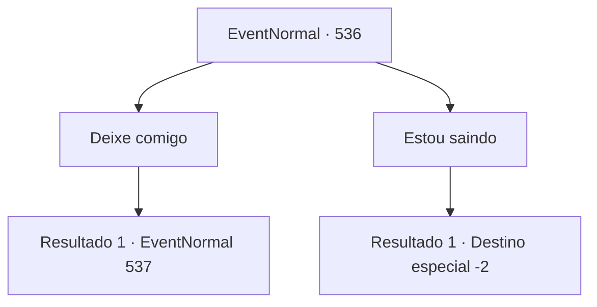

# Eventos normais · 536

[Índice da tabela](index.md) · [Índice geral](../index.md)

ID: `pt:EventNormal:536` · Fonte: `EventNormal4` · Versão: 1.2.47.

Mapeamento estático dos arquivos; a disponibilidade e a execução dependem do estado da run.

## Texto do evento

*Sem texto no arquivo.*

## Dados de entrada

```json
{
  "id": 536,
  "grade": 1,
  "place": "",
  "required": ""
}
```

## Mapa das escolhas



## Escolhas e resultados

### Escolha 1

Deixe comigo

Requisitos e outros campos da escolha:

```json
{
  "required": ""
}
```

#### Resultado 1.1

Você confiantemente pede à ela que deixe isso com você. Sandra olha para você, comovida, e concorda. A mão firme dela pega você pelo ombro. 

 "Oh... Oh! Obrigada! Muito obrigada! Vamos disfarçar você como eu."

 Você segue Sandra até a residência dela. 

 Quatro dias depois, disfarçado como Sandra, você entra na arena. Cercado por paredes circulares, o ar é quente e tem cheiro de peixe. Você olha em volta. A espada de Sandra ainda nas suas costas. Os gritos da platéia ressoaram. <link=shake> 

 "Woooooh!"

</link> Depois de esperar um pouco, as barras de ferro do outro lado se abrem com um 'cling'. O oponente é um orc gladiador. O orc olha para você e corre na sua direção com um machado gigante.

Continuação registrada: [Evento 537](0537.md) na mesma tabela.

```json
{
  "required": "",
  "chance": "1",
  "nextEvent": 537,
  "type": 2,
  "reward": "3_67_1|6_0_104",
  "place": 11
}
```

### Escolha 2

Estou saindo

Requisitos e outros campos da escolha:

```json
{
  "required": ""
}
```

#### Resultado 2.1

Depois de mudar de ideia, você balança a cabeça e sai de lá. Sandra não consegue esconder seu desapontamento.

Continuação registrada: [Destino especial `-2`](../destinos-especiais.md).

```json
{
  "required": "",
  "chance": "1",
  "nextEvent": -2,
  "type": 2,
  "reward": "5_234_10"
}
```

## Referências que chegam a este evento

- [Evento 535 · escolha 1 · resultado 1](0535.md#escolha-1)
