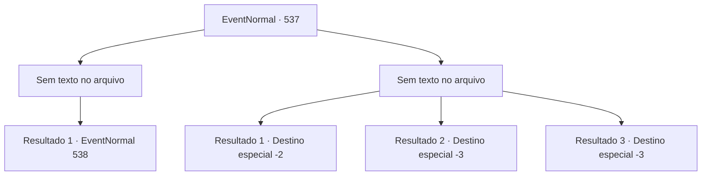

# Eventos normais · 537

[Índice da tabela](index.md) · [Índice geral](../index.md)

ID: `pt:EventNormal:537` · Fonte: `EventNormal4` · Versão: 1.2.47.

Mapeamento estático dos arquivos; a disponibilidade e a execução dependem do estado da run.

## Texto do evento

*Sem texto no arquivo.*

## Dados de entrada

```json
{
  "id": 537,
  "grade": 1,
  "place": "",
  "required": ""
}
```

## Mapa das escolhas



## Escolhas e resultados

### Escolha 1

*Sem texto no arquivo; o papel dessa opção depende da interface do jogo.*

Requisitos e outros campos da escolha:

```json
{
  "required": ""
}
```

#### Resultado 1.1

Você girou o machado de duas lâminas e cortou o pescoço do gladiador orc, fazendo o sangue jorrar e seu corpo desabar no chão. Os espectadores comemoraram sua vitória com entusiasmo. 

 "Uauuu!!"

 No entanto, a luta ainda não havia terminado. As grades se abriram novamente e, desta vez, um mantícora apareceu. 

 "Rrraaahh!!"

 A enorme mandíbula da mantícora avançou em sua direção.

Continuação registrada: [Evento 538](0538.md) na mesma tabela.

```json
{
  "required": "",
  "chance": "1",
  "nextEvent": 538,
  "type": 2,
  "reward": "6_0_96",
  "place": 11
}
```

### Escolha 2

*Sem texto no arquivo; o papel dessa opção depende da interface do jogo.*

Requisitos e outros campos da escolha:

```json
{
  "required": ""
}
```

#### Resultado 2.1

A espada de Sandra se quebrou e você foi derrotado. A escuridão se aproximou rapidamente e tomou sua consciência. De repente, você acordou ao som do vento.

 Sentiu uma dor latejante em todo o corpo e um cheiro pungente de ervas. Ao olhar ao redor, viu uma casa humilde e a figura de Sandra. 

 "Ei, você está acordado?!"

 Sandra, ao perceber que você havia despertado, derramou algo em sua boca. O gosto amargo fez você perceber que era uma poção. 

 "Fico feliz que tenha acordado."

 Ela jogou mais um pedaço de lenha na fogueira e levantou-se. 

 "Oh, sim. Eu vou te dar essa espada como um presente. É minha forma de retribuir o que você fez por mim. É decente o suficiente para usar."

 Ela entregou a você uma espada feita de mithril e partiu, dizendo que precisava encontrar seu irmão.

Continuação registrada: [Destino especial `-2`](../destinos-especiais.md).

```json
{
  "required": "1_0_2|1_1_2",
  "chance": "1",
  "nextEvent": -2,
  "type": 2,
  "reward": "0_0_-1|0_1_-1|4_67_1|3_75_1|5_234_10"
}
```

#### Resultado 2.2

A espada de Sandra foi quebrada pelo machado que o orc brandiu. E o machado atingiu você bem no peito. Sangue quente espirrou no chão e você sentiu sua visão embaçar. O momento da morte se aproximou com a escuridão total.

Continuação registrada: [Destino especial `-3`](../destinos-especiais.md).

```json
{
  "required": "2_0_2",
  "chance": "1",
  "nextEvent": -3,
  "type": 2,
  "reward": "0_0_-1|0_1_-1|4_67_1"
}
```

#### Resultado 2.3

A espada de Sandra foi quebrada pelo machado que o orc brandiu. E o machado atingiu você bem no peito. Sangue quente espirrou no chão e você sentiu sua visão embaçar. O momento da morte se aproximou com a escuridão total.

Continuação registrada: [Destino especial `-3`](../destinos-especiais.md).

```json
{
  "required": "2_1_2",
  "chance": "1",
  "nextEvent": -3,
  "type": 2,
  "reward": "0_0_-1|0_1_-1|4_67_1"
}
```

## Referências que chegam a este evento

- [Evento 536 · escolha 1 · resultado 1](0536.md#escolha-1)
