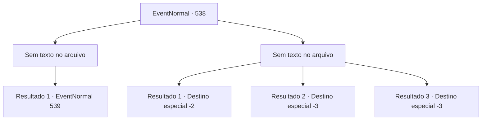

# Eventos normais · 538

[Índice da tabela](index.md) · [Índice geral](../index.md)

ID: `pt:EventNormal:538` · Fonte: `EventNormal4` · Versão: 1.2.47.

Mapeamento estático dos arquivos; a disponibilidade e a execução dependem do estado da run.

## Texto do evento

*Sem texto no arquivo.*

## Dados de entrada

```json
{
  "id": 538,
  "grade": 1,
  "place": "",
  "required": ""
}
```

## Mapa das escolhas



## Escolhas e resultados

### Escolha 1

*Sem texto no arquivo; o papel dessa opção depende da interface do jogo.*

Requisitos e outros campos da escolha:

```json
{
  "required": ""
}
```

#### Resultado 1.1

Você rapidamente cortou a cabeça da mantícora que se aproximava, com um único golpe. A cabeça do mantícora voou pelo ar, espalhando sangue, antes de cair no chão. Você controlou sua respiração e esperou pelo próximo oponente. 

 "Uooooh!!"

 Pouco depois, as grades se abriram revelando o último oponente: um gigante das colinas segurando um enorme porrete. O gigante das colinas entrou na arena, enfurecido, e balançou o porrete.

Continuação registrada: [Evento 539](0539.md) na mesma tabela.

```json
{
  "required": "",
  "chance": "1",
  "nextEvent": 539,
  "type": 2,
  "reward": "6_0_132",
  "place": 11
}
```

### Escolha 2

*Sem texto no arquivo; o papel dessa opção depende da interface do jogo.*

Requisitos e outros campos da escolha:

```json
{
  "required": ""
}
```

#### Resultado 2.1

Depois de ter sua espada, a Espada de Sandra, quebrada e ter sido derrotado, você foi consumido pela escuridão em um piscar de olhos. No entanto, você gradualmente despertou ao som de uma brisa repentina.

 Sentiu uma dor latejante em todo o corpo e percebeu o aroma pungente de ervas. Ao virar o olhar, viu a humilde casa e Sandra diante de você. 

 "Ei, você está acordado?"

 disse Sandra, confirmando que você havia despertado. Ela derramou algo em sua boca. Você percebeu o gosto amargo e entendeu que era uma poção. 

 "Que bom que você acordou"

 disse ela. Sandra pegou mais um pedaço de lenha para alimentar a fogueira e se levantou. 

 "Oh, sim. Tome, esta espada é um presente para você. É uma retribuição por ter me ajudado. Deve servir razoavelmente bem."

 Ela entregou a você uma espada feita de mithril e partiu, dizendo que precisava encontrar seu irmão.

Continuação registrada: [Destino especial `-2`](../destinos-especiais.md).

```json
{
  "required": "1_0_2|1_1_2",
  "chance": "1",
  "nextEvent": -2,
  "type": 2,
  "reward": "0_0_-1|0_1_-1|4_67_1|3_75_1|5_234_10"
}
```

#### Resultado 2.2

Um espinho disparado da mantícora perfurou sua garganta, fazendo seus movimentos ficarem lentos. O mantícora não perdeu esse momento. 

 "Graaah!!"

 De repente, a mantícora investiu contra você, arrancando sua garganta. Esse foi seu último momento vivo.

Continuação registrada: [Destino especial `-3`](../destinos-especiais.md).

```json
{
  "required": "2_0_2",
  "chance": "1",
  "nextEvent": -3,
  "type": 2,
  "reward": "0_0_-1|0_1_-1"
}
```

#### Resultado 2.3

Um espinho disparado da mantícora perfurou sua garganta, fazendo seus movimentos ficarem lentos. O mantícora não perdeu esse momento. 

 "Graaah!!"

 De repente, a mantícora investiu contra você, arrancando sua garganta. Esse foi seu último momento vivo.

Continuação registrada: [Destino especial `-3`](../destinos-especiais.md).

```json
{
  "required": "2_1_2",
  "chance": "1",
  "nextEvent": -3,
  "type": 2,
  "reward": "0_0_-1|0_1_-1"
}
```

## Referências que chegam a este evento

- [Evento 537 · escolha 1 · resultado 1](0537.md#escolha-1)
