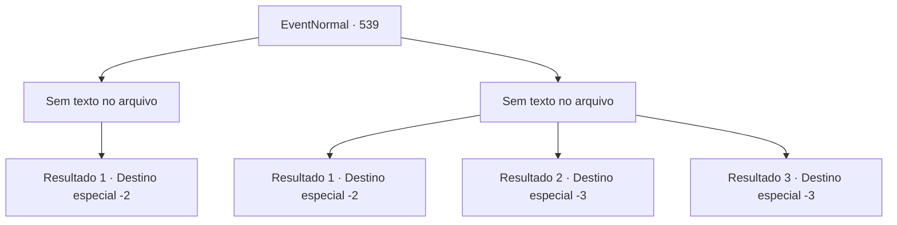

# Eventos normais · 539

[Índice da tabela](index.md) · [Índice geral](../index.md)

ID: `pt:EventNormal:539` · Fonte: `EventNormal4` · Versão: 1.2.47.

Mapeamento estático dos arquivos; a disponibilidade e a execução dependem do estado da run.

## Texto do evento

*Sem texto no arquivo.*

## Dados de entrada

```json
{
  "id": 539,
  "grade": 1,
  "place": "",
  "required": ""
}
```

## Mapa das escolhas



## Escolhas e resultados

### Escolha 1

*Sem texto no arquivo; o papel dessa opção depende da interface do jogo.*

Requisitos e outros campos da escolha:

```json
{
  "required": ""
}
```

#### Resultado 1.1


 "Sandra! Sandra! Sandra!"

 O imenso corpo do gigante do morro caiu com um estrondo ensurdecedor. Os espectadores que assistiam à luta aclamaram Sandra, e o som de aplausos retumbantes ecoou como trovões.

 Você deixou para trás o campo de batalha manchado de sangue e seguiu em direção à saída. No portão da arena de lutas, Sandra esperava por você. Ela o abraçou novamente e expressou sua gratidão repetidamente. De repente, olhando para a espada em suas costas, Sandra disse: 

 "Oh, é verdade! Continue usando essa espada. É um item valioso, então pode ser uma pequena retribuição."

 Após se despedir de Sandra, você partiu com passos confiantes.

Continuação registrada: [Destino especial `-2`](../destinos-especiais.md).

```json
{
  "required": "",
  "chance": "1",
  "nextEvent": -2,
  "type": 2,
  "reward": "5_234_10|0_3_1"
}
```

### Escolha 2

*Sem texto no arquivo; o papel dessa opção depende da interface do jogo.*

Requisitos e outros campos da escolha:

```json
{
  "required": ""
}
```

#### Resultado 2.1

A espada grande de Sandra está quebrada e você está derrotado. A escuridão se abateu sobre você em um instante, tirando sua consciência.

 De repente, você ouviu o som do vento e gradualmente abriu os olhos. Uma dor aguda percorria todo o seu corpo, acompanhada do aroma reconfortante de ervas. Ao virar o olhar, viu a figura de Sandra em uma casa modesta. 

 "Ei, você está consciente?"

 Depois de confirmar que você acordou, Sandra derramou algo em sua boca. O gosto amargo fez você perceber que era remédio. 

 "Estou feliz que você acordou."

 Ela jogou outro pedaço de madeira no fogo e se levantou. 

 "Ah, sim. Aqui está. Tome esta espada como um presente. É uma retribuição por ter lutado por mim. Deve ser útil o suficiente."

 Ela entregou a você uma espada feita de mithril e saiu, dizendo que precisava encontrar seu irmão.

Continuação registrada: [Destino especial `-2`](../destinos-especiais.md).

```json
{
  "required": "1_0_2|1_1_2",
  "chance": "1",
  "nextEvent": -2,
  "type": 2,
  "reward": "0_0_-1|0_1_-1|4_67_1|3_75_1|5_234_10"
}
```

#### Resultado 2.2

O corpo colossal do gigante da colina te esmagou impiedosamente. Você foi esmagado sob o peso avassalador, sem poder sequer oferecer resistência, resultando em sua morte.

Continuação registrada: [Destino especial `-3`](../destinos-especiais.md).

```json
{
  "required": "2_0_2",
  "chance": "1",
  "nextEvent": -3,
  "type": 2,
  "reward": "0_0_-1|0_1_-1"
}
```

#### Resultado 2.3

O corpo colossal do gigante da colina te esmagou impiedosamente. Você foi esmagado sob o peso avassalador, sem poder sequer oferecer resistência, resultando em sua morte.

Continuação registrada: [Destino especial `-3`](../destinos-especiais.md).

```json
{
  "required": "2_1_2",
  "chance": "1",
  "nextEvent": -3,
  "type": 2,
  "reward": "0_0_-1|0_1_-1"
}
```

## Referências que chegam a este evento

- [Evento 538 · escolha 1 · resultado 1](0538.md#escolha-1)
