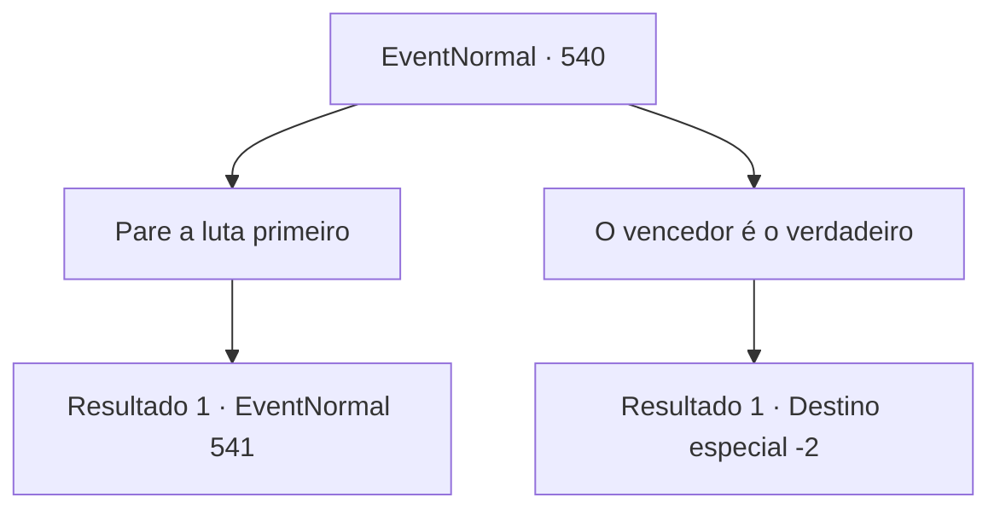

# Eventos normais · 540

[Índice da tabela](index.md) · [Índice geral](../index.md)

ID: `pt:EventNormal:540` · Fonte: `EventNormal4` · Versão: 1.2.47.

Mapeamento estático dos arquivos; a disponibilidade e a execução dependem do estado da run.

## Texto do evento

Você encontra se depara com uma situação estranha no centro de uma pequena vila. Dois homens que pareciam gêmeos lutando até a morte. Os dois homens estavam discutindo um entre eles sobre qual seria deles seria 'Kennis'. 

 "Eu sou o verdadeiro! Seu falsário!"

 "Não diga besteira. Sou eu! Eu sou o real!"

 Enquanto você olha a cena, uma mulher se aproxima de você e pede ajuda. O nome dela é Sophia, e ela diz que é a esposa de Kennis. 

 "Com licença... aventureiro. Me ajude a descobrir qual é meu verdadeiro marido!"


## Dados de entrada

```json
{
  "id": 540,
  "grade": 1,
  "place": "",
  "required": "5_494_0"
}
```

## Mapa das escolhas



## Escolhas e resultados

### Escolha 1

Pare a luta primeiro

Requisitos e outros campos da escolha:

```json
{
  "required": ""
}
```

#### Resultado 1.1

Você aceita o pedido de Sophia e para a briga entre os dois homens. Os dois Kennis arfam, relaxam as mãos e olham para você ao mesmo tempo. 

 "Aventureiro! Eu sou o Kennis real!"

 "Não! Esse cara é um falsário! Eu sou o verdadeiro Kennis!"

 Você olha para os dois Kennis. Os dois homens parecem exatamente iguais da cabeça aos pés, mas há apenas uma diferença. A cor do cachecol deles é diferente. Um tem um cachecol preto e o outro tem um cachecol vermelho.

Continuação registrada: [Evento 541](0541.md) na mesma tabela.

```json
{
  "required": "",
  "chance": "1",
  "nextEvent": 541,
  "type": 2,
  "reward": ""
}
```

### Escolha 2

O vencedor é o verdadeiro

Requisitos e outros campos da escolha:

```json
{
  "required": ""
}
```

#### Resultado 2.1

Você dá a resposta à Sophia e sai. A resposta é: o lado que vencer é o verdadeiro. A sua recomendação faz o som da luta ficar ainda mais intenso.

Continuação registrada: [Destino especial `-2`](../destinos-especiais.md).

```json
{
  "required": "",
  "chance": "1",
  "nextEvent": -2,
  "type": 2,
  "reward": "5_494_10"
}
```

## Referências que chegam a este evento

Nenhum `nextEvent` positivo da mesma tabela aponta para este nó. Isso não prova que seja inacessível: sorteio e estado de história podem selecioná-lo.

