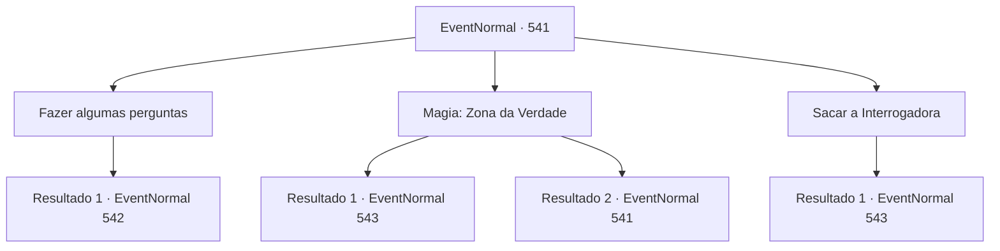

# Eventos normais · 541

[Índice da tabela](index.md) · [Índice geral](../index.md)

ID: `pt:EventNormal:541` · Fonte: `EventNormal4` · Versão: 1.2.47.

Mapeamento estático dos arquivos; a disponibilidade e a execução dependem do estado da run.

## Texto do evento

*Sem texto no arquivo.*

## Dados de entrada

```json
{
  "id": 541,
  "grade": 1,
  "place": "",
  "required": ""
}
```

## Mapa das escolhas



## Escolhas e resultados

### Escolha 1

Fazer algumas perguntas

Requisitos e outros campos da escolha:

```json
{
  "required": ""
}
```

#### Resultado 1.1

Você decide fazer uma pergunta para determinar quem é o verdadeiro Kennis. Os dois Kennis ouvem você falar.

Continuação registrada: [Evento 542](0542.md) na mesma tabela.

```json
{
  "required": "",
  "chance": "1",
  "nextEvent": 542,
  "type": 2,
  "reward": ""
}
```

### Escolha 2

Magia: Zona da Verdade

Requisitos e outros campos da escolha:

```json
{
  "required": "20_0_1|18_495_1"
}
```

#### Resultado 2.1

Você conjura Zona da Verdade, bloqueando mentiras. Então você pergunta aos dois Kennis quem é o real. A resposta para sua pergunta vem do homem com o cachecol vermelho. Ele grita que é o verdadeiro, enquanto o homem com o cachecol preto só cobre a boca.  

Continuação registrada: [Evento 543](0543.md) na mesma tabela.

```json
{
  "required": "",
  "chance": "1|0_7_1|0_12_1",
  "nextEvent": 543,
  "type": 0,
  "reward": ""
}
```

#### Resultado 2.2

Você conjura Zona da Verdade, bloqueando mentiras. Então você pergunta aos dois Kennis quem é o real. Em resposta à sua pergunta, ambos dizem que são o verdadeiro.  

Continuação registrada: [Evento 541](0541.md) na mesma tabela.

```json
{
  "required": "",
  "chance": "15",
  "nextEvent": 541,
  "type": 1,
  "reward": "5_495_1"
}
```

### Escolha 3

Sacar a Interrogadora

Requisitos e outros campos da escolha:

```json
{
  "required": "8_93_1"
}
```

#### Resultado 3.1

Você pega a Interrogadora. Então você pergunta aos dois Kennis quem é o real. Em resposta à sua pergunta, os dois Kennis gritam, um para o outro, dizendo que são reais. Nessa hora, a Interrogadora voa na direção do homem com o cachecol preto. 

 "Heeek!"

 A Interrogadora se pressiona contra o pescoço dele, mas para logo depois.

Continuação registrada: [Evento 543](0543.md) na mesma tabela.

```json
{
  "required": "",
  "chance": "1",
  "nextEvent": 543,
  "type": 2,
  "reward": ""
}
```

## Referências que chegam a este evento

- [Evento 540 · escolha 1 · resultado 1](0540.md#escolha-1)
- [Evento 541 · escolha 2 · resultado 2](0541.md#escolha-2)
