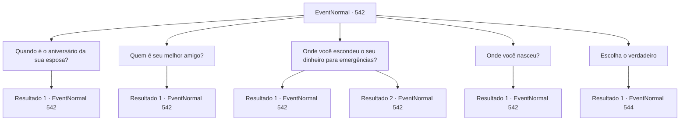

# Eventos normais · 542

[Índice da tabela](index.md) · [Índice geral](../index.md)

ID: `pt:EventNormal:542` · Fonte: `EventNormal4` · Versão: 1.2.47.

Mapeamento estático dos arquivos; a disponibilidade e a execução dependem do estado da run.

## Texto do evento

*Sem texto no arquivo.*

## Dados de entrada

```json
{
  "id": 542,
  "grade": 1,
  "place": "",
  "required": ""
}
```

## Mapa das escolhas



## Escolhas e resultados

### Escolha 1

Quando é o aniversário da sua esposa?

Requisitos e outros campos da escolha:

```json
{
  "required": "5_496_0"
}
```

#### Resultado 1.1

Você pergunta a ambos os Kennis quando é o aniversário da esposa dele. Mas ambos os homens erram a resposta e apenas franzem os lábios. Sophia, que estava assistindo, grita, batendo no peito. 

 "Como você pode não saber o aniversário da sua esposa? Vocês dois!"

 Você acalma a enraivecida Sophia, depois volta aos dois homens.

Continuação registrada: [Evento 542](0542.md) na mesma tabela.

```json
{
  "required": "",
  "chance": "1",
  "nextEvent": 542,
  "type": 2,
  "reward": "5_496_9"
}
```

### Escolha 2

Quem é seu melhor amigo?

Requisitos e outros campos da escolha:

```json
{
  "required": "5_497_0"
}
```

#### Resultado 2.1

Você pergunta a ambos os Kennis quem é são os melhores amigos deles. Os dois homens gritam a mesma resposta com confiança. 

 "É 'Theron', na minha cidade natal. Ele me deu esse cachecol preto quando eu saí de lá!"

 "É 'Theron', na minha cidade natal. Ele me deu esse cachecol vermelho quando eu saí de lá!"

 Os dois Kennis, que deram a mesma resposta ao mesmo tempo, se encaram.

Continuação registrada: [Evento 542](0542.md) na mesma tabela.

```json
{
  "required": "",
  "chance": "1",
  "nextEvent": 542,
  "type": 2,
  "reward": "5_497_9"
}
```

### Escolha 3

Onde você escondeu o seu dinheiro para emergências?

Requisitos e outros campos da escolha:

```json
{
  "required": "5_498_0"
}
```

#### Resultado 3.1

Você pergunta aos Kennis onde eles esconderam o dinheiro de emergência. Os dois Kennis tem reações conflitantes à sua pergunta. 

 "Como assim dinheiro de emergência? Não tenho isso!"

 "Meu fundo de emergência? Eu escondi no armário."

 O Kennis que se esquiva da pergunta é o com o cachecol vermelho, e o que responde calmamente é o Kennis do cachecol preto. Kennis vestindo o cachecol preto exclama, confiantemente. 

 "Olha esse mentiroso! Como um homem que nem sabe onde está o fundo de emergência pode ser o real? Eu sou o verdadeiro Kennis!"

 Sophia rosna enquanto encara os dois Kennis. 

 "Há! Você fingiu que isso não existia até quando EU perguntei!"


Continuação registrada: [Evento 542](0542.md) na mesma tabela.

```json
{
  "required": "18_495_1",
  "chance": "1",
  "nextEvent": 542,
  "type": 2,
  "reward": "5_498_9"
}
```

#### Resultado 3.2

Você pergunta aos Kennis onde eles esconderam o dinheiro de emergência. Os dois Kennis tem reações conflitantes à sua pergunta. 

 "..."

 "Meu fundo de emergência? Eu escondi atrás do armário."

 O Kennis vestindo o cachecol vermelho consegue dizer nada, enquanto o Kennis do cachecol preto, rapidamente vem com uma resposta. O Kennis vestindo o cachecol preto, exclama, confiantemente. 

 "Olha esse mentiroso! Como um homem que nem sabe onde está o fundo de emergência pode ser o real? Eu sou o verdadeiro Kennis!"

 Sophia rosna enquanto encara os dois Kennis. 

 "Há! Você fingiu que isso não existia até quando EU perguntei!"


Continuação registrada: [Evento 542](0542.md) na mesma tabela.

```json
{
  "required": "5_495_1",
  "chance": "1",
  "nextEvent": 542,
  "type": 2,
  "reward": "5_498_9"
}
```

### Escolha 4

Onde você nasceu?

Requisitos e outros campos da escolha:

```json
{
  "required": "5_499_0"
}
```

#### Resultado 4.1

Você pergunta aos Kennis de onde eles são. Os dois homens gritam ao mesmo tempo, assim que a pergunta é feita. 

 "Uma vila chamada 'Terunai' no Império Zaipent!"

 "Uma vila chamada 'Terunai' no Império Zaipent!"

 Os dois Kennis, que responderam rapidamente, fazem contato visual e se encaram Sophia fica entre os dois e impede a briga antes mesmo de começar, apenas com uma encarada.

Continuação registrada: [Evento 542](0542.md) na mesma tabela.

```json
{
  "required": "",
  "chance": "1",
  "nextEvent": 542,
  "type": 2,
  "reward": "5_499_9"
}
```

### Escolha 5

Escolha o verdadeiro

Requisitos e outros campos da escolha:

```json
{
  "required": "-1|5_496_9|5_497_9|5_498_9|5_499_9"
}
```

#### Resultado 5.1

Depois de fazer várias perguntas, você chega a uma conclusão. Você chama os dois Kennis e Sophia, e conta a eles o que você pensa.

Continuação registrada: [Evento 544](0544.md) na mesma tabela.

```json
{
  "required": "",
  "chance": "1",
  "nextEvent": 544,
  "type": 2,
  "reward": ""
}
```

## Referências que chegam a este evento

- [Evento 541 · escolha 1 · resultado 1](0541.md#escolha-1)
- [Evento 542 · escolha 1 · resultado 1](0542.md#escolha-1)
- [Evento 542 · escolha 2 · resultado 1](0542.md#escolha-2)
- [Evento 542 · escolha 3 · resultado 1](0542.md#escolha-3)
- [Evento 542 · escolha 3 · resultado 2](0542.md#escolha-3)
- [Evento 542 · escolha 4 · resultado 1](0542.md#escolha-4)
