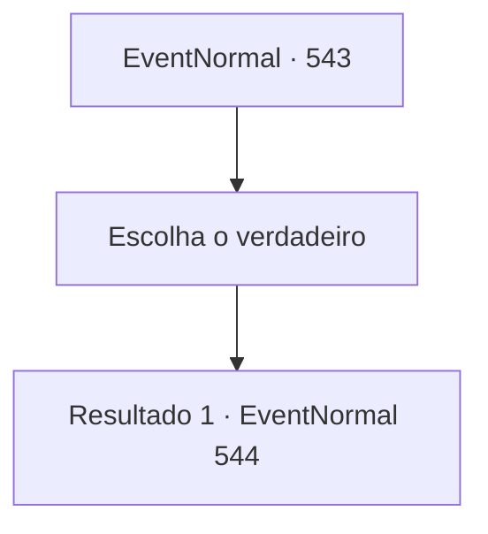

# Eventos normais · 543

[Índice da tabela](index.md) · [Índice geral](../index.md)

ID: `pt:EventNormal:543` · Fonte: `EventNormal4` · Versão: 1.2.47.

Mapeamento estático dos arquivos; a disponibilidade e a execução dependem do estado da run.

## Texto do evento

*Sem texto no arquivo.*

## Dados de entrada

```json
{
  "id": 543,
  "grade": 1,
  "place": "",
  "required": ""
}
```

## Mapa das escolhas



## Escolhas e resultados

### Escolha 1

Escolha o verdadeiro

Requisitos e outros campos da escolha:

```json
{
  "required": ""
}
```

#### Resultado 1.1

Depois de fazer várias perguntas, você chega a uma conclusão.  Você chama os dois Kennis e Sophia, e conta a eles o que você pensa.

Continuação registrada: [Evento 544](0544.md) na mesma tabela.

```json
{
  "required": "",
  "chance": "1",
  "nextEvent": 544,
  "type": 2,
  "reward": ""
}
```

## Referências que chegam a este evento

- [Evento 541 · escolha 2 · resultado 1](0541.md#escolha-2)
- [Evento 541 · escolha 3 · resultado 1](0541.md#escolha-3)
