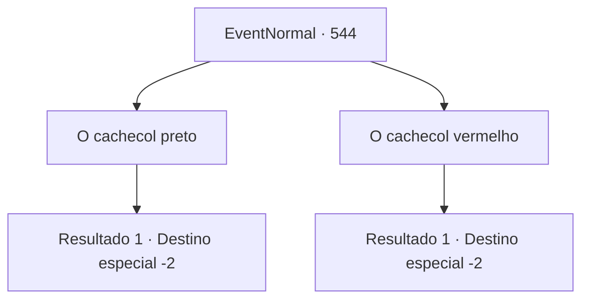

# Eventos normais · 544

[Índice da tabela](index.md) · [Índice geral](../index.md)

ID: `pt:EventNormal:544` · Fonte: `EventNormal4` · Versão: 1.2.47.

Mapeamento estático dos arquivos; a disponibilidade e a execução dependem do estado da run.

## Texto do evento

*Sem texto no arquivo.*

## Dados de entrada

```json
{
  "id": 544,
  "grade": 1,
  "place": "",
  "required": ""
}
```

## Mapa das escolhas



## Escolhas e resultados

### Escolha 1

O cachecol preto

Requisitos e outros campos da escolha:

```json
{
  "required": ""
}
```

#### Resultado 1.1

Você diz que o homem do cachecol preto é o verdadeiro. O Kennis com cachecol vermelho se retorce com vergonha, mas Sophia imediatamente chama os guardas, que prendem o falsário. 

 "Não! Sophia! Estou te dizendo a verdade! Arrgh!"

 Enquanto o Kennis falso é arrastado pelos guardas, Sophia se aproxima de você e lhe agradece. 

 "Muito obrigada, aventureiro! Você me ajudou a descobrir quem era meu marido de verdade!"

 Ela convida você para a casa dela, dizendo que quer recompensar você. Você vai com o casal até o lar deles. Elhes lhe oferecem uma recepção calorosa e depois você tem uma boa noite de descanso.

Continuação registrada: [Destino especial `-2`](../destinos-especiais.md).

```json
{
  "required": "",
  "chance": "1",
  "nextEvent": -2,
  "type": 2,
  "reward": "0_2_1|0_0_1|0_1_1|5_494_10"
}
```

### Escolha 2

O cachecol vermelho

Requisitos e outros campos da escolha:

```json
{
  "required": ""
}
```

#### Resultado 2.1

Você diz que o homem do cachecol vermelho é o verdadeiro. Então o Kennis com o cachecol preto, grita, xinga e depois se vira e sai correndo. 

 "Que droga!"

 O falsário então é pego pelos guardas na tentativa de fuga. A sua verdadeira natureza é então revelada, ele é um doppelganger com pele cinza e um rosto sem características. Quando o doppelganger é levado, Sophia vem até você e lhe agradece. 

 "Muito obrigada, aventureiro! Você me ajudou a descobrir quem era meu marido de verdade!"

 Ela convida você para a casa dela, dizendo que quer recompensar você. Você vai com o casal até o lar deles. Elhes lhe oferecem uma recepção calorosa e depois você tem uma boa noite de descanso.

Continuação registrada: [Destino especial `-2`](../destinos-especiais.md).

```json
{
  "required": "",
  "chance": "1",
  "nextEvent": -2,
  "type": 2,
  "reward": "0_2_1|0_0_1|0_1_1|5_494_10"
}
```

## Referências que chegam a este evento

- [Evento 542 · escolha 5 · resultado 1](0542.md#escolha-5)
- [Evento 543 · escolha 1 · resultado 1](0543.md#escolha-1)
