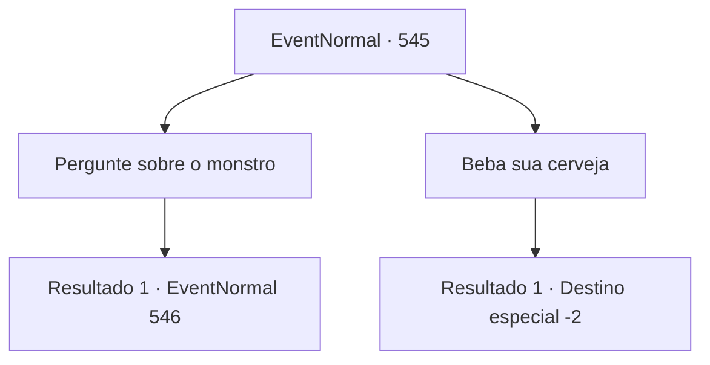

# Eventos normais · 545

[Índice da tabela](index.md) · [Índice geral](../index.md)

ID: `pt:EventNormal:545` · Fonte: `EventNormal4` · Versão: 1.2.47.

Mapeamento estático dos arquivos; a disponibilidade e a execução dependem do estado da run.

## Texto do evento

Você entra em um bar em uma pequena vila para descansar um pouco. Uma história interessante flui de para fora de uma mesa do bar chamado 'Cebola Negra'. Enquanto espera pelo seu pedido de comida e cerveja, você ouve a história. 

 "É um monstro! Era um monstro que nunca vi antes! Eu vi, com certeza!"

 Um homem com uma cicatriz na testa alega, batendo no peito. Mas nenhum dos amigos à mesa parecia acreditar nele. 

 "Então, um monstro com uma cabeça de osso e um corpo de pé-grande apareceu na floresta perto da vila? Como isso pode fazer algum sentido? Você já está bêbado?"

 Eles riem e voltam a beber.

## Dados de entrada

```json
{
  "id": 545,
  "grade": 1,
  "place": "",
  "required": "5_510_0|1_4_10|1_2_40|2_2_70"
}
```

## Mapa das escolhas



## Escolhas e resultados

### Escolha 1

Pergunte sobre o monstro

Requisitos e outros campos da escolha:

```json
{
  "required": ""
}
```

#### Resultado 1.1

Você se aproxima da mesa para perguntar sobre os detalhes. O homem responde à sua pergunta com uma voz séria. 

 "Cerca de 20 minutos da vila, você pode encontrar a 'Floresta Rake', lá tem uma pedra que parece um pássaro. Eu vi o monstro lá perto!"

 O homem descreve o monstro para você. De acordo com ele, o monstro tem um crânio de veado como cabeça e o corpo coberto por pelos, como um Pé-Grande. Mas os amigos dele pareciam mais interessados na cerveja do que no que ele diz ter visto. O homem aperta sua mão e pergunta. 

 "Você é um aventureiro, não é? Por favor, dê uma olhada se há um monstro lá ou não! Eu vou recompensar você!"


Continuação registrada: [Evento 546](0546.md) na mesma tabela.

```json
{
  "required": "",
  "chance": "1",
  "nextEvent": 546,
  "type": 2,
  "reward": ""
}
```

### Escolha 2

Beba sua cerveja

Requisitos e outros campos da escolha:

```json
{
  "required": ""
}
```

#### Resultado 2.1

Enquanto você ouve a história, a janta e cerveja que você pediu chegam. Você bebe sua cerveja gelada e se livra do seu interesse em monstros. 

Continuação registrada: [Destino especial `-2`](../destinos-especiais.md).

```json
{
  "required": "",
  "chance": "1",
  "nextEvent": -2,
  "type": 2,
  "reward": "0_1_1|5_510_10|0_4_-10"
}
```

## Referências que chegam a este evento

Nenhum `nextEvent` positivo da mesma tabela aponta para este nó. Isso não prova que seja inacessível: sorteio e estado de história podem selecioná-lo.

