# Eventos normais · 546

[Índice da tabela](index.md) · [Índice geral](../index.md)

ID: `pt:EventNormal:546` · Fonte: `EventNormal4` · Versão: 1.2.47.

Mapeamento estático dos arquivos; a disponibilidade e a execução dependem do estado da run.

## Texto do evento

*Sem texto no arquivo.*

## Dados de entrada

```json
{
  "id": 546,
  "grade": 1,
  "place": "",
  "required": ""
}
```

## Mapa das escolhas

```mermaid
flowchart TD
  E["EventNormal · 546"]
  C0["Vá para a &#x27;Floresta Rake&#x27;"]
  E --> C0
  R0_0["Resultado 1 · EventNormal 547"]
  C0 --> R0_0
  C1["Recuse"]
  E --> C1
  R1_0["Resultado 1 · Destino especial -2"]
  C1 --> R1_0
```



## Escolhas e resultados

### Escolha 1

Vá para a 'Floresta Rake'

Requisitos e outros campos da escolha:

```json
{
  "required": ""
}
```

#### Resultado 1.1

Você decide fazer um favor ao homem e vai até o arvoredo. A floresta não fica longe do bar, então você chega lá rapidamente. Depois de andar por cerca de dez minutos na entrada da floresta, você vê a pedra com formato de pássaro que o homem disse. Você toca na pedra-pássaro e olha em volta.

Continuação registrada: [Evento 547](0547.md) na mesma tabela.

```json
{
  "required": "",
  "chance": "1",
  "nextEvent": 547,
  "type": 2,
  "reward": ""
}
```

### Escolha 2

Recuse

Requisitos e outros campos da escolha:

```json
{
  "required": ""
}
```

#### Resultado 2.1

Enquanto você ouve a história, a janta e cerveja que você pediu chegam. Você recusa o pedido do homem e volta ao seu assento. Você bebe sua cerveja gelada e se livra do seu interesse em monstros. 

Continuação registrada: [Destino especial `-2`](../destinos-especiais.md).

```json
{
  "required": "",
  "chance": "1",
  "nextEvent": -2,
  "type": 2,
  "reward": "0_1_1|5_510_10"
}
```

## Referências que chegam a este evento

- [Evento 545 · escolha 1 · resultado 1](0545.md#escolha-1)
