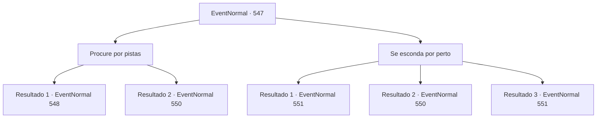

# Eventos normais · 547

[Índice da tabela](index.md) · [Índice geral](../index.md)

ID: `pt:EventNormal:547` · Fonte: `EventNormal4` · Versão: 1.2.47.

Mapeamento estático dos arquivos; a disponibilidade e a execução dependem do estado da run.

## Texto do evento

*Sem texto no arquivo.*

## Dados de entrada

```json
{
  "id": 547,
  "grade": 1,
  "place": "",
  "required": ""
}
```

## Mapa das escolhas



## Escolhas e resultados

### Escolha 1

Procure por pistas

Requisitos e outros campos da escolha:

```json
{
  "required": ""
}
```

#### Resultado 1.1

Você olha em volta, procurando por sinais de monstros. Enquanto isso, o sol se põem e a escuridão chega à floresta. Então, de repente, você vê pegadas esvaecidas deixadas perto da pedra. As pegadas parecem pertencer a um Pé-Grande. Você lentamente caminha junto das pegadas. Logo depois, uma caverna, que estava escondida por arbustos densos, aparece. 

 "Wooooh!!"

 Lá está o monstro que o homem descreveu. É um Pé-Grande machucado, com um crânio de veado na cabeça. Ele é muito maior que um Pé-Grande comum. Ele parece ser um exemplar muito raro, chamado de Chefe. O Chefe Pé-Grande encara para você com olhos vermelhos furiosos. Quando seus olhos se encontram, ele vem correndo com um grito.

Continuação registrada: [Evento 548](0548.md) na mesma tabela.

```json
{
  "required": "",
  "chance": "1|0_14_1",
  "nextEvent": 548,
  "type": 0,
  "reward": ""
}
```

#### Resultado 1.2

Você olha em volta, procurando por sinais de monstros. Enquanto isso, o sol se põem e a escuridão chega à floresta. Depois de falhar em encontrar o monstro, você retorna ao bar. Quando você chega ao bar, o homem que lhe pediu o favor se aproxima. 

 "O que aconteceu? Você encontrou o monstro? Hã?"

 Os amigos dele olham para você ao ouvir a pergunta do homem.

Continuação registrada: [Evento 550](0550.md) na mesma tabela.

```json
{
  "required": "",
  "chance": "14",
  "nextEvent": 550,
  "type": 1,
  "reward": ""
}
```

### Escolha 2

Se esconda por perto

Requisitos e outros campos da escolha:

```json
{
  "required": ""
}
```

#### Resultado 2.1

Você se esconde perto de uma rocha e espera pelo monstro. Enquanto isso, o sol se põem e a escuridão chega à floresta. Você cuidadosamente olha por cima da rocha no primeiro sinal de movimento. Uma grande criatura peluda aparece, andando por meio aos arbustos e entrando em uma caverna, até então escondida. Como o homem disse, o monstro tinha um crânio de veado na cabeça. E era muito maior que um Pé-Grande comum. Ele parece ser um exemplar muito raro, chamado de Chefe.

Continuação registrada: [Evento 551](0551.md) na mesma tabela.

```json
{
  "required": "20_5_3",
  "chance": "1",
  "nextEvent": 551,
  "type": 2,
  "reward": "5_511_1"
}
```

#### Resultado 2.2

Você se esconde perto de uma rocha e espera pelo monstro. Enquanto isso, o sol se põem e a escuridão chega à floresta. Depois de falhar em encontrar o monstro, você retorna ao bar. Quando você chega ao bar, o homem que lhe pediu o favor se aproxima. 

 "O que aconteceu? Você encontrou o monstro? Hã?"

 Os amigos dele olham para você ao ouvir a pergunta do homem.

Continuação registrada: [Evento 550](0550.md) na mesma tabela.

```json
{
  "required": "21_5_3",
  "chance": "14",
  "nextEvent": 550,
  "type": 1,
  "reward": ""
}
```

#### Resultado 2.3

Você se esconde perto de uma rocha e espera pelo monstro. Enquanto isso, o sol se põem e a escuridão chega à floresta. Você cuidadosamente olha por cima da rocha no primeiro sinal de movimento. Uma grande criatura peluda aparece, andando por meio aos arbustos e entrando em uma caverna, até então escondida. Como o homem disse, o monstro tinha um crânio de veado na cabeça. E era muito maior que um Pé-Grande comum. Ele parece ser um exemplar muito raro, chamado de Chefe.

Continuação registrada: [Evento 551](0551.md) na mesma tabela.

```json
{
  "required": "21_5_3",
  "chance": "1|0_7_1",
  "nextEvent": 551,
  "type": 0,
  "reward": "5_511_1"
}
```

## Referências que chegam a este evento

- [Evento 546 · escolha 1 · resultado 1](0546.md#escolha-1)
