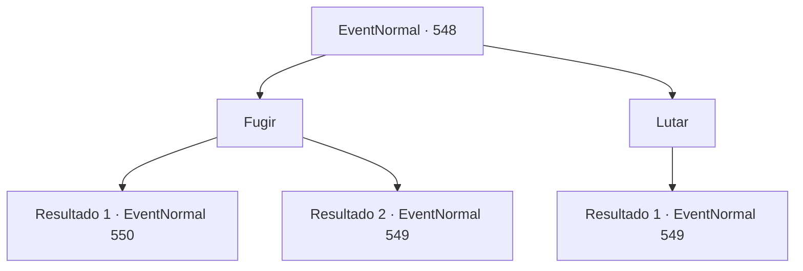

# Eventos normais · 548

[Índice da tabela](index.md) · [Índice geral](../index.md)

ID: `pt:EventNormal:548` · Fonte: `EventNormal4` · Versão: 1.2.47.

Mapeamento estático dos arquivos; a disponibilidade e a execução dependem do estado da run.

## Texto do evento

*Sem texto no arquivo.*

## Dados de entrada

```json
{
  "id": 548,
  "grade": 1,
  "place": "",
  "required": ""
}
```

## Mapa das escolhas



## Escolhas e resultados

### Escolha 1

Fugir

Requisitos e outros campos da escolha:

```json
{
  "required": ""
}
```

#### Resultado 1.1

Você foge do Pé-Grande com a caveira. E vai diretamente de volta ao bar. Quando você chega ao bar, o homem que lhe pediu o favor se aproxima. 

 "O que aconteceu? Você encontrou o monstro? Hã?"

 Os amigos dele olham para você ao ouvir a pergunta do homem.

Continuação registrada: [Evento 550](0550.md) na mesma tabela.

```json
{
  "required": "",
  "chance": "1|0_6_1",
  "nextEvent": 550,
  "type": 0,
  "reward": "5_511_1"
}
```

#### Resultado 1.2

Você tenta fugir do Pé-Grande com a caveira. Mas ele para você num piscar de olhos. Então ele joga um dos punhos na sua direção.

Continuação registrada: [Evento 549](0549.md) na mesma tabela.

```json
{
  "required": "",
  "chance": "14",
  "nextEvent": 549,
  "type": 1,
  "reward": "6_2_31",
  "place": 1
}
```

### Escolha 2

Lutar

Requisitos e outros campos da escolha:

```json
{
  "required": ""
}
```

#### Resultado 2.1

Você decide lutar contra o Pé-Grande com a caveira. Ele usa seus grandes punhos contra você.

Continuação registrada: [Evento 549](0549.md) na mesma tabela.

```json
{
  "required": "",
  "chance": "1",
  "nextEvent": 549,
  "type": 2,
  "reward": "6_2_31",
  "place": 1
}
```

## Referências que chegam a este evento

- [Evento 547 · escolha 1 · resultado 1](0547.md#escolha-1)
