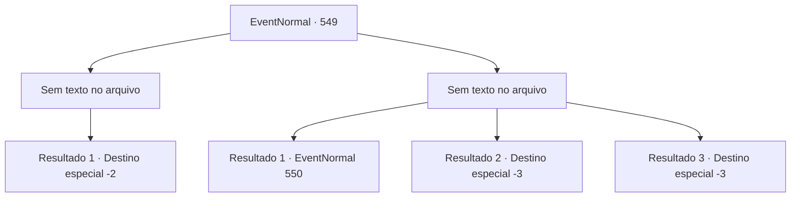

# Eventos normais · 549

[Índice da tabela](index.md) · [Índice geral](../index.md)

ID: `pt:EventNormal:549` · Fonte: `EventNormal4` · Versão: 1.2.47.

Mapeamento estático dos arquivos; a disponibilidade e a execução dependem do estado da run.

## Texto do evento

*Sem texto no arquivo.*

## Dados de entrada

```json
{
  "id": 549,
  "grade": 1,
  "place": "",
  "required": ""
}
```

## Mapa das escolhas



## Escolhas e resultados

### Escolha 1

*Sem texto no arquivo; o papel dessa opção depende da interface do jogo.*

Requisitos e outros campos da escolha:

```json
{
  "required": ""
}
```

#### Resultado 1.1

Você se livra do Chefe Pé-Grande e corta a cabeça dele, então volta ao bar. Quando você chega ao bar, o homem que lhe pediu o favor se aproxima. 

 "O que aconteceu? Você encontrou o monstro? Hã?"

 Você mostra ao homem a cabeça do Chefe Pé-Grande. Então os amigos dele ficam surpresos e pulam de suas cadeiras. 

 "Nossa...! Olha isso! Eu estava certo! Haha, hahaha!"

 Os amigos dele viram as cabeças, com vergonha, enquanto o homem brada. Outros no bar o cercam para ver a cabeça do monstro. 

 "Incrível! Não posso acreditar nisso! Você realmente pegou um Chefe Pé-Grande!"

 Depois de um tempo, o homem, com uma expressão satisfeita, lhe entrega um livro. Então ele diz 

 "Obrigado. Eu consegui isso na cidade. Vou dar a você."

 Você embrulha o livro e se despede do homem, depois sai do bar.

Continuação registrada: [Destino especial `-2`](../destinos-especiais.md).

```json
{
  "required": "",
  "chance": "1",
  "nextEvent": -2,
  "type": 2,
  "reward": "3_221_1|5_510_10"
}
```

### Escolha 2

*Sem texto no arquivo; o papel dessa opção depende da interface do jogo.*

Requisitos e outros campos da escolha:

```json
{
  "required": ""
}
```

#### Resultado 2.1

Perdendo para o chefe, você corre freneticamente. O chefe persegue você por um tempo mas volta ao covil quando você sai da floresta. Você arrasta seu corpo machucado de volta ao bar. O homem que lhe pediu o favor diz, com um olhar surpreso 

 "O que houve? Pelo que vejo... você encontrou um monstro, não?"


Continuação registrada: [Evento 550](0550.md) na mesma tabela.

```json
{
  "required": "1_0_2|1_1_2",
  "chance": "1",
  "nextEvent": 550,
  "type": 2,
  "reward": "0_0_-1|0_1_-1|5_511_1"
}
```

#### Resultado 2.2

Sua cabeça é esmagada pelo punho do Pé-Grande. O golpe tira a sua vida de uma vez, então a dor não durou.

Continuação registrada: [Destino especial `-3`](../destinos-especiais.md).

```json
{
  "required": "2_0_2",
  "chance": "1",
  "nextEvent": -3,
  "type": 2,
  "reward": "0_0_-1|0_1_-1"
}
```

#### Resultado 2.3

Sua cabeça é esmagada pelo punho do Pé-Grande.  O golpe tira a sua vida de uma vez, então a dor não durou.

Continuação registrada: [Destino especial `-3`](../destinos-especiais.md).

```json
{
  "required": "2_1_2",
  "chance": "1",
  "nextEvent": -3,
  "type": 2,
  "reward": "0_0_-1|0_1_-1"
}
```

## Referências que chegam a este evento

- [Evento 548 · escolha 1 · resultado 2](0548.md#escolha-1)
- [Evento 548 · escolha 2 · resultado 1](0548.md#escolha-2)
- [Evento 551 · escolha 2 · resultado 3](0551.md#escolha-2)
