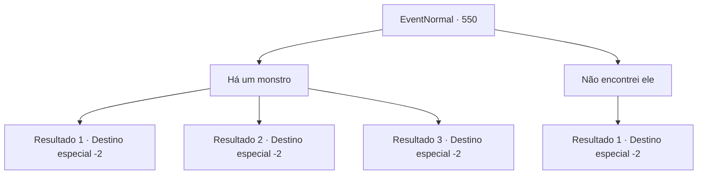

# Eventos normais · 550

[Índice da tabela](index.md) · [Índice geral](../index.md)

ID: `pt:EventNormal:550` · Fonte: `EventNormal4` · Versão: 1.2.47.

Mapeamento estático dos arquivos; a disponibilidade e a execução dependem do estado da run.

## Texto do evento

*Sem texto no arquivo.*

## Dados de entrada

```json
{
  "id": 550,
  "grade": 1,
  "place": "",
  "required": ""
}
```

## Mapa das escolhas



## Escolhas e resultados

### Escolha 1

Há um monstro

Requisitos e outros campos da escolha:

```json
{
  "required": ""
}
```

#### Resultado 1.1

Você responde com indiferença que, realmente, havia um monstro lá. O homem ouve sua resposta e começa a rir e gritar para os amigos dele. 

 "Olhem isso! Eu estava certo! Hahahaha!"

 Os amigos dele viram as cabeças, com vergonha, enquanto o homem brada. Depois de um tempo, o homem, com uma expressão satisfeita, lhe entrega um livro. Então ele diz 

 "Obrigado. Eu consegui isso na cidade. Vou dar a você."

 Você embrulha o livro e se despede do homem, depois sai do bar.

Continuação registrada: [Destino especial `-2`](../destinos-especiais.md).

```json
{
  "required": "18_511_1",
  "chance": "1|0_12_1",
  "nextEvent": -2,
  "type": 0,
  "reward": "3_221_1|5_510_10"
}
```

#### Resultado 1.2

Você gagueja enquanto tenta responder se havia um monstro lá. Os amigos do homem que estavam olhando para você começam a chorar de rir. 

 "Hahaha! Tem certeza que tinha algum um monstro? Você parece tão envergonhado!"

 Com toda a risada, você sai do bar depressa.

Continuação registrada: [Destino especial `-2`](../destinos-especiais.md).

```json
{
  "required": "18_511_1",
  "chance": "18",
  "nextEvent": -2,
  "type": 1,
  "reward": "5_510_10"
}
```

#### Resultado 1.3

Você responde que havia um Chefe Pé-Grande e explica com detalhes onde ele está se escondendo. O homem ouve sua resposta e começa a rir e gritar para os amigos dele.  

 "Olhem isso! Eu estava certo! Hahahaha!"

  Os amigos dele viram as cabeças, com vergonha, enquanto o homem brada.  Depois de um tempo, o homem, com uma expressão satisfeita, lhe entrega um livro.  Então ele diz  

 "Obrigado. Eu consegui isso na cidade. Vou dar a você."

  Você embrulha o livro e se despede do homem, depois sai do bar.

Continuação registrada: [Destino especial `-2`](../destinos-especiais.md).

```json
{
  "required": "5_511_1",
  "chance": "1",
  "nextEvent": -2,
  "type": 2,
  "reward": "3_221_1|5_510_10"
}
```

### Escolha 2

Não encontrei ele

Requisitos e outros campos da escolha:

```json
{
  "required": ""
}
```

#### Resultado 2.1

Você responde que você não encontrou o monstro. Os amigos do homem que estavam olhando para você começam a chorar de rir. 

 "Puahaha! Olha isso! O que há?"

 As risadas fazem o homem corar de vergonha. Você dá um tapinha no ombro dele e sai do bar.

Continuação registrada: [Destino especial `-2`](../destinos-especiais.md).

```json
{
  "required": "",
  "chance": "1",
  "nextEvent": -2,
  "type": 2,
  "reward": "5_510_10"
}
```

## Referências que chegam a este evento

- [Evento 547 · escolha 1 · resultado 2](0547.md#escolha-1)
- [Evento 547 · escolha 2 · resultado 2](0547.md#escolha-2)
- [Evento 548 · escolha 1 · resultado 1](0548.md#escolha-1)
- [Evento 549 · escolha 2 · resultado 1](0549.md#escolha-2)
- [Evento 551 · escolha 1 · resultado 1](0551.md#escolha-1)
