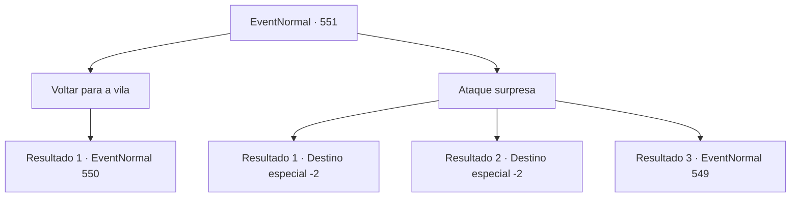

# Eventos normais · 551

[Índice da tabela](index.md) · [Índice geral](../index.md)

ID: `pt:EventNormal:551` · Fonte: `EventNormal4` · Versão: 1.2.47.

Mapeamento estático dos arquivos; a disponibilidade e a execução dependem do estado da run.

## Texto do evento

*Sem texto no arquivo.*

## Dados de entrada

```json
{
  "id": 551,
  "grade": 1,
  "place": "",
  "required": ""
}
```

## Mapa das escolhas



## Escolhas e resultados

### Escolha 1

Voltar para a vila

Requisitos e outros campos da escolha:

```json
{
  "required": ""
}
```

#### Resultado 1.1

Você checa a existência do monstro e volta ao bar da vila. Quando você chega ao bar, o homem que lhe pediu o favor se aproxima.  

 "O que aconteceu? Você encontrou o monstro? Hã?"

  Os amigos dele olham para você ao ouvir a pergunta do homem.

Continuação registrada: [Evento 550](0550.md) na mesma tabela.

```json
{
  "required": "",
  "chance": "1",
  "nextEvent": 550,
  "type": 2,
  "reward": ""
}
```

### Escolha 2

Ataque surpresa

Requisitos e outros campos da escolha:

```json
{
  "required": ""
}
```

#### Resultado 2.1

Você ataca as costas do Chefe Pé-Grande. Então, sem fazer juz à palavra 'chefe', ele cai morto com apenas um golpe. Quando você olha para o cadáver, ele já estava cheio de ferimentos. Você se livra do Chefe Pé-Grande e corta a cabeça dele, então volta ao bar. Quando você chega ao bar, o homem que lhe pediu o favor se aproxima. 

 "O que aconteceu? Você encontrou o monstro? Hã?"

 Você mostra ao homem a cabeça do Chefe Pé-Grande. Então os amigos dele ficam surpresos e pulam de suas cadeiras. 

 "Nossa...! Olha isso! Eu estava certo! Haha, hahaha!"

 Os amigos dele viram as cabeças, com vergonha, enquanto o homem brada. Outros no bar o cercam para ver a cabeça do monstro. 

 "Incrível! Não posso acreditar nisso! Você realmente pegou um Chefe Pé-Grande!"

 Depois de um tempo, o homem, com uma expressão satisfeita, lhe entrega um livro. Então ele diz 

 "Obrigado. Eu consegui isso na cidade. Vou dar a você."

 Você embrulha o livro e se despede do homem, depois sai do bar.

Continuação registrada: [Destino especial `-2`](../destinos-especiais.md).

```json
{
  "required": "",
  "chance": "1|0_6_1",
  "nextEvent": -2,
  "type": 0,
  "reward": "0_2_1|3_221_1|5_510_10"
}
```

#### Resultado 2.2

Você ataca as costas do Chefe Pé-Grande.  Então, sem fazer juz à palavra 'chefe', ele cai morto com apenas um golpe.  Quando você olha para o cadáver, ele já estava cheio de ferimentos.  Você se livra do Chefe Pé-Grande e corta a cabeça dele, então volta ao bar.  Quando você chega ao bar, o homem que lhe pediu o favor se aproxima.  

 "O que aconteceu? Você encontrou o monstro? Hã?"

  Você mostra ao homem a cabeça do Chefe Pé-Grande.  Então os amigos dele ficam surpresos e pulam de suas cadeiras.  

 "Nossa...! Olha isso! Eu estava certo! Haha, hahaha!"

  Os amigos dele viram as cabeças, com vergonha, enquanto o homem brada.  Outros no bar o cercam para ver a cabeça do monstro.  

 "Incrível! Não posso acreditar nisso! Você realmente pegou um Chefe Pé-Grande!"

  Depois de um tempo, o homem, com uma expressão satisfeita, lhe entrega um livro.  Então ele diz  

 "Obrigado. Eu consegui isso na cidade. Vou dar a você."

  Você embrulha o livro e se despede do homem, depois sai do bar.

Continuação registrada: [Destino especial `-2`](../destinos-especiais.md).

```json
{
  "required": "20_5_3",
  "chance": "1|0_6_1",
  "nextEvent": -2,
  "type": 0,
  "reward": "0_2_1|3_221_1|5_510_10"
}
```

#### Resultado 2.3

Você ataca as costas do Chefe Pé-Grande. Ele rapidamente se esquiva do ataque, como se já tivesse notado que você. 

 "Woooo!"

 Ele então ruge e prepara seus braços enormes.

Continuação registrada: [Evento 549](0549.md) na mesma tabela.

```json
{
  "required": "",
  "chance": "14",
  "nextEvent": 549,
  "type": 1,
  "reward": "6_2_31",
  "place": 1
}
```

## Referências que chegam a este evento

- [Evento 547 · escolha 2 · resultado 1](0547.md#escolha-2)
- [Evento 547 · escolha 2 · resultado 3](0547.md#escolha-2)
