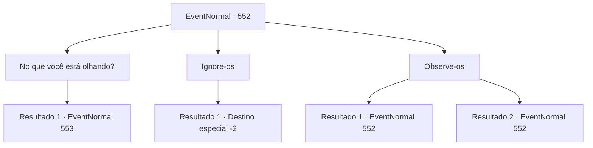

# Eventos normais · 552

[Índice da tabela](index.md) · [Índice geral](../index.md)

ID: `pt:EventNormal:552` · Fonte: `EventNormal4` · Versão: 1.2.47.

Mapeamento estático dos arquivos; a disponibilidade e a execução dependem do estado da run.

## Texto do evento

Você está caminhando pelas ruas de 'Hanela', uma bela cidade famosa por sua coleção de prédios brancos que brilham intensamente sob o sol. O local também é lar da universidade teológica 'Ravada Solar', onde novos padres e clérigos que adoram a divindade da luz são educados. |drawing_ravadaSolar| Lá, você se depara com um grupo de jovens com rostos sombrios, se destacando da atmosfera alegre e brilhante da cidade. Eles estão te encarando em silêncio, consumindo seus sanduíches como se estivessem mastigando algum pergaminho.

## Dados de entrada

```json
{
  "id": 552,
  "grade": 1,
  "place": "",
  "required": "5_627_0"
}
```

## Mapa das escolhas



## Escolhas e resultados

### Escolha 1

No que você está olhando?

Requisitos e outros campos da escolha:

```json
{
  "required": ""
}
```

#### Resultado 1.1

Você pergunta a eles pelo que estão olhando. Um dos jovens responde, limpando migalhas da boca. 

 "Ahem... Um. Bem-vindo. É sempre refrescante ver um estrangeiro... Seria correto assumir que você é um aventureiro?"


Continuação registrada: [Evento 553](0553.md) na mesma tabela.

```json
{
  "required": "",
  "chance": "1",
  "nextEvent": 553,
  "type": 2,
  "reward": "5_627_1"
}
```

### Escolha 2

Ignore-os

Requisitos e outros campos da escolha:

```json
{
  "required": ""
}
```

#### Resultado 2.1

Você ignora e passa por eles.

Continuação registrada: [Destino especial `-2`](../destinos-especiais.md).

```json
{
  "required": "",
  "chance": "1",
  "nextEvent": -2,
  "type": 2,
  "reward": "5_627_10"
}
```

### Escolha 3

Observe-os

Requisitos e outros campos da escolha:

```json
{
  "required": "5_628_0"
}
```

#### Resultado 3.1

Você examina lentamente a juventude. Túnicas cinzentas decoradas com símbolos amarelos do sol se estendendo em todas as direções, os colares em forma de diamante feitos de prata... Parece que você está falando com um grupo de estudantes de Ravada Solar. Julgando pela cor de suas bochechas e seu movimento cambaleante, você conclui que eles devem estar sofrendo de ressaca.

Continuação registrada: [Evento 552](0552.md) na mesma tabela.

```json
{
  "required": "",
  "chance": "1|0_7_1",
  "nextEvent": 552,
  "type": 0,
  "reward": "5_628_1"
}
```

#### Resultado 3.2

Você examina lentamente a juventude. Túnicas cinzentas decoradas com símbolos amarelos do sol se estendendo em todas as direções, os colares em forma de diamante feitos de prata... Mas, você falha em lembrar para onde tudo isso aponta.

Continuação registrada: [Evento 552](0552.md) na mesma tabela.

```json
{
  "required": "",
  "chance": "10",
  "nextEvent": 552,
  "type": 1,
  "reward": "5_628_2"
}
```

## Referências que chegam a este evento

- [Evento 552 · escolha 3 · resultado 1](0552.md#escolha-3)
- [Evento 552 · escolha 3 · resultado 2](0552.md#escolha-3)
